## Design -- Data Flow Diagram
Epic: [#42](https://github.com/CPSC490-Team-Proj/CPSC490-G07-MightyMorphin/issues/42) · Stories: [#40](https://github.com/CPSC490-Team-Proj/CPSC490-G07-MightyMorphin/issues/40)
Owner: Christopher Pham · Sprint: 2 · Status: Draft

```mermaid
---
config:
  theme: base
---
flowchart LR
    provider(["Authorized employee<br/>(uploader)"]) -- "upload digital PDF" --> pdfFile["PDF File"]
    provider -- "paper document" --> physicalMedia["Physical Media"]
    physicalMedia -- scan --> scanner["Scanner"]
    scanner -- conversion --> pdfFile
    pdfFile -- "store original · keep reference" --> pdfArchive[("Edwards Document System<br/>(original PDFs)")]
    pdfArchive -- "read PDF" --> pdfExtractor["OCR Extraction<br/>(default for every document)"]
    pdfExtractor -- raw data --> extractedData["Extracted Data"]
    extractedData -- review --> reviewer["Validate Data"]
    reviewer -- approve --> storedData[("Snowflake<br/>(provisional)")]
    reviewer -- "flag / not approved" --> faulty["Pending / Flagged Queue"]
    faulty -- "notify uploader" --> provider
    faulty -- "correct values" --> reviewer
    faulty -- "bad extraction: re-extract" --> pdfArchive
    faulty -- "bad scan: re-scan" --> scanner
    reviewer -- "log correction / approval" --> auditLog[("Audit Log")]

    storedData -- automatic processing --> filterEngine["Filter Engine"]
    filterEngine -- cleaned data --> outputData["Filtered Output"]

    analyst(["Authorized employee<br/>(analyst)"]) -- submit query --> queryProcess["Query Process"]
    queryProcess -- retrieve already-filtered data --> outputData
    queryProcess -- "log view" --> auditLog
    outputData -- view results --> analyst
    analyst -- "review/report creation" --> analysis["Analysis, Reporting and Export<br/>(PDF, DOC, CSV)"]
    analysis -- "log export" --> auditLog
    admin(["System Administrator"]) -- "export audit log" --> auditLog

    reviewer@{ shape: diam}
```

## What the diagram shows

Documents enter in two ways: an employee uploads a PDF that was created on a
computer, or a paper document is scanned into a PDF first. Either way the
original goes to Edwards' document system and the application keeps only a
reference to it. Every document is read with OCR by default. A user with
permission validates the extracted values: approved values go into Snowflake
(provisional choice, #78); anything not approved waits in the pending/flagged
queue, the uploader is notified, and the document stays there until it is
corrected, re-extracted or re-scanned and then approved. Corrections,
approvals, views and exports are written to an audit log that only the system
administrator can export. Users sign in with Edwards' Microsoft SSO before
uploading or querying.

## What is NOT designed yet

- **Does not convey AI utilization.** All data provided, created, or reviewed is illustrated to be done by hand.
- **Data scrape may be more complex.** Diagram shows data scraped directly to validation then storing, but the illustration may be more simple than it looks.
- **Filter Engine.** Whether search reads Snowflake directly or goes through a separate filtering step (or a folder that feeds Snowflake) is not decided yet (#78).
- **Where extracted values wait during review.** Values are not stored in Snowflake until approval; how they are held while a document is pending is not designed yet.
