## Design -- Data Flow Diagram
Epic: [#42](https://github.com/CPSC490-Team-Proj/CPSC490-G07-MightyMorphin/issues/42) · Stories: [#40](https://github.com/CPSC490-Team-Proj/CPSC490-G07-MightyMorphin/issues/40)
Owner: Christopher Pham · Sprint: 2 · Status: Draft

```mermaid
---
config:
  theme: base
---
flowchart LR
 subgraph snowflake["Snowflake"]
        storedData["Ingested Data"]
        extractedData["Extracted Data"]
        validationChecks["Validate Data<br>3 checks per document"]
        reviewer["Confidence meets ~90% threshold?"]
        faulty["Pending / Flagged Queue"]
  end
    provider(["Authorized employee<br>(uploader)"]) -- "upload already-scanned or digital PDF" --> pdfFile["PDF File"]
    pdfFile -- store original · keep reference --> pdfArchive[("Edwards Document System<br>(original PDFs)")]
    pdfArchive -- read PDF --> pdfExtractor["OCR Extraction<br>(default for every document)"]
    pdfExtractor -- save document --> awsDocuments["AWS Document Storage (S3 bucket)"]
    pdfExtractor -- store extracted data --> storedData
    storedData -- raw data --> extractedData
    extractedData -- validate --> validationChecks
    validationChecks -- confidence result --> reviewer
    reviewer -- below threshold: flag --> faulty
    faulty -- correct values / revalidate --> validationChecks
    faulty -- notify uploader --> provider
    faulty -- "bad extraction: re-extract" --> pdfArchive
    faulty -- "poor-quality PDF: request replacement" --> provider
    reviewer -- log correction / approval --> auditLog[("Audit Log")]
    reviewer -- meets threshold --> filterEngine["Filter Engine"]
    filterEngine -- cleaned data --> outputData["Filtered Output"]
    analyst(["Authorized employee<br>(analyst)"]) -- submit query --> queryProcess["Query Process"]
    queryProcess -- "retrieve already-filtered data" --> outputData
    queryProcess -- log view --> auditLog
    outputData -- view results --> analyst
    analyst -- review/report creation --> analysis["Analysis, Reporting and Export<br>(PDF, DOC, CSV)"]
    analysis -- log export --> auditLog
    admin(["Manager"]) -- view audit logs / investigate issues --> auditLog

    reviewer@{ shape: diam}
    awsDocuments@{ shape: rect}
```

## What the diagram shows

Documents enter through an employee uploading a PDF that was created on a computer or a computer scanned PDF. The original goes to Edward's document sytem and the application keeps only a reference to it. Every document is read with OCR by default. The document gets saved to an AWS document storage (S3 bucket). The extracted data gets ingested by Snowflake where its validated (3 times per document) and is presented with a confidence test. If it doesn't pass the 90% threshold it gets flagged and put into a queue to be corrected, re-extracted, or re-scanned and then approved (looping through until approved). Once it meets the 90% threshold authorized employees can make changes. All corrections,approvals, views and exports are written to an audit log that only the manager can export.

## What is NOT designed yet

- **Does not convey AI utilization.** All data provided, created, or reviewed is illustrated to be done by hand.
- **Data scrape may be more complex.** Diagram shows data scraped directly to validation then storing, but the illustration may be more simple than it looks.
- **Filter Engine.** Whether search reads Snowflake directly or goes through a separate filtering step (or a folder that feeds Snowflake) is not decided yet (#78).