## Design -- Data Flow Diagram
Epic: [#42](https://github.com/CPSC490-Team-Proj/CPSC490-G07-MightyMorphin/issues/42) · Stories: [#40] (https://github.com/CPSC490-Team-Proj/CPSC490-G07-MightyMorphin/issues/40)
Owner: Christopher Pham · Sprint: 2 · Status: Draft

```mermaid
---
config:
  theme: base
---
flowchart LR
    provider(["User/Data Provider"]) -- input media --> physicalMedia["Physical Media"]
    physicalMedia -- scan --> scanner["Scanner"]
    scanner -- conversion --> pdfFile["PDF File"]
    pdfFile -- store --> pdfArchive[("PDF Archive")]
    pdfArchive -- scraping --> pdfExtractor["PDF Data Scraper"]
    pdfExtractor -- raw data --> extractedData["Extracted Data"]
    extractedData -- review --> reviewer["Validate Data"]
    reviewer -- approve --> storedData[("AWS Database")]
    reviewer -- reject --> faulty["faulty Data"]
    storedData -- processing --> filterEngine["Filter Engine"]
    filterEngine -- cleaned data --> outputData["Filtered Output"]
    faulty -- "bad extraction: re-scrape" --> pdfArchive
    faulty -- "bad scan: re-scan" --> scanner
    outputData -- retrieve query --> analyst(["User/Analyst"])
    analyst -- review/report creation --> analysis["Analysis and Reporting"]

    reviewer@{ shape: diam}
```

## What is NOT designed yet

- **Does not convey AI utilization.** All data provided, created, or reviewed is illustrated to be do done by hand.
- **Data scrape may be more complex.** Diagram shows data scraped directely to validation then storing, but the illustration may be more simple than it looks.
- **Flagging of data during validation specification.** Direction in how review takes place during validation of data is unclear but will be specified. (whether separate database for flagged items is necessary, how will items be flagged through algorithm or AI)