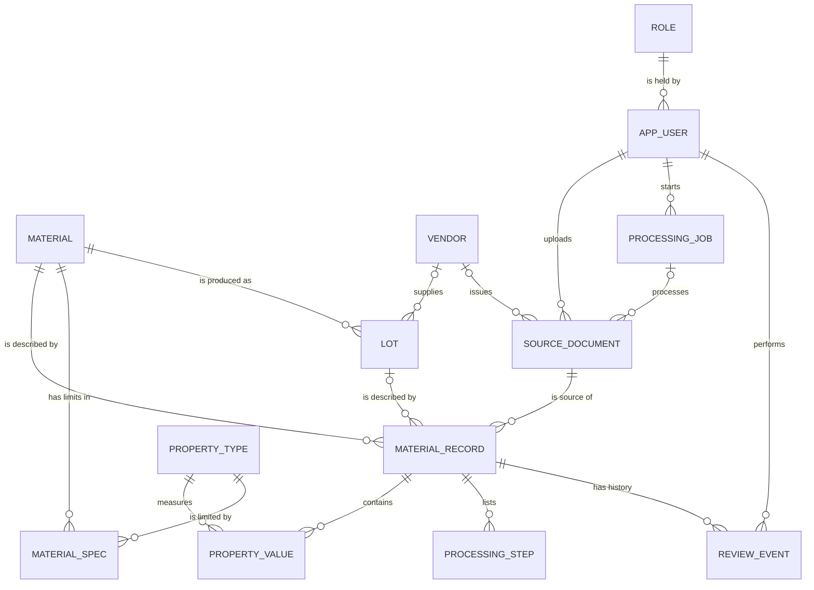
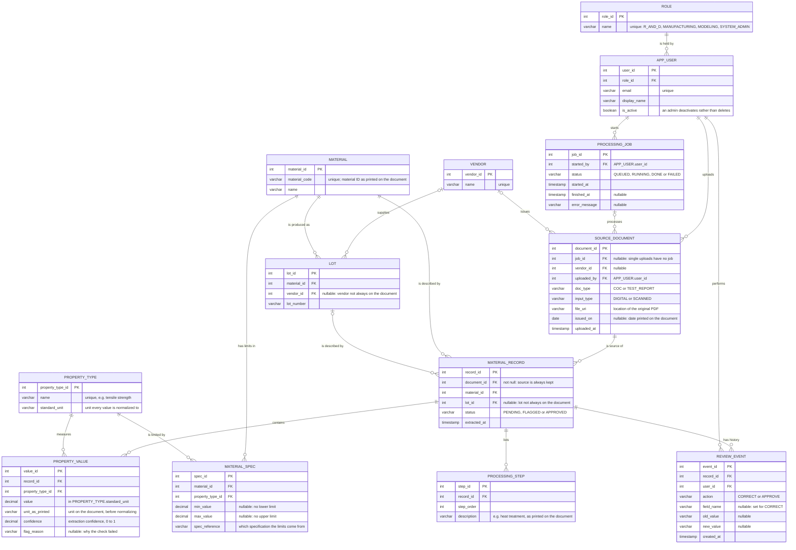

## Design -- ER Diagram
Epic: [#42](https://github.com/CPSC490-Team-Proj/CPSC490-G07-MightyMorphin/issues/42) · Stories: [#48](https://github.com/CPSC490-Team-Proj/CPSC490-G07-MightyMorphin/issues/48), [#18](https://github.com/CPSC490-Team-Proj/CPSC490-G07-MightyMorphin/issues/18), [#20](https://github.com/CPSC490-Team-Proj/CPSC490-G07-MightyMorphin/issues/20) · Task: [#38](https://github.com/CPSC490-Team-Proj/CPSC490-G07-MightyMorphin/issues/38) 
Owner: Fidelis Okorie · Sprint: 2 · Status: draft

In this document, it defines the relational data model for the verified material
data described in proposal §3: "materials, mechanical properties, documents,
vendors, and lots as related records", where "every record keeps a reference
to the original PDF" and "each correction and approval is logged." It also
stores what the use cases in the use case diagram ([#36](https://github.com/CPSC490-Team-Proj/CPSC490-G07-MightyMorphin/issues/36), in review in PR #68) need;
§3 maps each use case to the tables that support it.

## 1. Entity-relationship diagram

### 1.1 Overview

The tables and how they connect, without their columns. This is the version
shown in the proposal (§4, Figure 2).

*Figure 1 — ER overview. Read each line end as "how many" of the table it
touches:*

| Line end | Mermaid code | Means |
|---|---|---|
| two bars | `\|\|` | exactly one |
| one bar and a circle | `\|o` | zero or one (optional: used where the vendor, lot or job may be missing from a document) |
| circle and fork (three prongs) | `o{` | zero or many |

*Example: the line from `SOURCE_DOCUMENT` (two bars) to `MATERIAL_RECORD`
(circle and fork) reads "each material record comes from exactly one
source document; a document can be the source of zero or many records."*

### 1.2 Full diagram with columns

*Figure 2 — Full ER diagram with each table's columns, keys and types.
Read it with Figure 1 for the relationships.*

## 2. Entities

| Entity | What one row is | Requirement it satisfies |
|---|---|---|
| `ROLE` | one of the four actors in the use case diagram | #36: Manage User Permissions |
| `APP_USER` | an authorized Edwards user | §3: uploads, reviews and approvals are made by a user; #36: Manage User Accounts |
| `PROCESSING_JOB` | one batch of uploaded documents being processed | #36: Batch Process Documents, Monitor Processing Jobs |
| `VENDOR` | a supplier named on a CoC or test report | #18: "support vendor information when available" |
| `MATERIAL` | a material identified by its material ID | #18: "represent materials" |
| `LOT` | one production lot of a material | #18: "support lot information when available" |
| `PROPERTY_TYPE` | one kind of mechanical property and its standard unit | #18: "represent mechanical properties"; lets values and limits be compared |
| `MATERIAL_SPEC` | the allowed range of one property for one material | #36: View Material Specifications, Compare Data to Specifications, Identify Out-of-Spec Materials |
| `SOURCE_DOCUMENT` | one uploaded PDF | #18: "distinguish CoCs from material test reports" (`doc_type`); #20: source identified as CoC or test report |
| `MATERIAL_RECORD` | the material data extracted from one document | #20: "each extracted material record shall retain a reference to its source document" (`document_id`, not null) |
| `PROPERTY_VALUE` | one mechanical property value | #18: "represent mechanical properties associated with materials"; §3 verification checks (units, confidence) |
| `PROCESSING_STEP` | one processing step printed on the document | #36: View Material Processing Info |
| `REVIEW_EVENT` | one correction or approval | §3: "each correction and approval is logged"; #36: Validate Extracted Data |

## 3. Use case coverage

Every use case in the use case diagram (#36) maps to the tables that
hold its data. Use cases marked *derived* need no table of their own: they are
queries over tables already listed.

| Use case (#36) | Tables |
|---|---|
| Import PDF Documents | `SOURCE_DOCUMENT` |
| Batch Process Documents | `PROCESSING_JOB`, `SOURCE_DOCUMENT.job_id` |
| Extract Material Data | `MATERIAL_RECORD`, `PROPERTY_VALUE`, `PROCESSING_STEP` |
| Validate Extracted Data | `MATERIAL_RECORD.status`, `PROPERTY_VALUE.flag_reason`, `REVIEW_EVENT` |
| Import Material Records | `MATERIAL_RECORD` with `status = APPROVED` |
| Search / Filter Material Records | `MATERIAL`, `VENDOR`, `LOT`, `SOURCE_DOCUMENT.doc_type` |
| View Material Specifications | `MATERIAL_SPEC` |
| View Material Properties | `PROPERTY_VALUE`, `PROPERTY_TYPE` |
| View Material Processing Info | `PROCESSING_STEP` |
| Compare Data to Specifications | *derived*: `PROPERTY_VALUE` joined to `MATERIAL_SPEC` on material and property type |
| View Historical Material Trends | *derived*: `PROPERTY_VALUE` ordered by `SOURCE_DOCUMENT.issued_on` |
| Identify Out-of-Spec Materials | *derived*: values outside `MATERIAL_SPEC.min_value` / `max_value` |
| View Mechanical Property Ranges | *derived*: minimum and maximum of `PROPERTY_VALUE.value` per property type |
| Manage User Accounts | `APP_USER` |
| Manage User Permissions | `ROLE`, `APP_USER.role_id` |
| Monitor Processing Jobs | `PROCESSING_JOB` |

## 4. Relationships

1. A `SOURCE_DOCUMENT` produces one or more `MATERIAL_RECORD`s. Each
   `MATERIAL_RECORD` has exactly one source document, so a value can always be
   traced back to its PDF (#20).
2. A `MATERIAL_RECORD` is for one `MATERIAL` and, when the document gives
   one, one `LOT`.
3. A `MATERIAL_RECORD` holds many `PROPERTY_VALUE`s and `PROCESSING_STEP`s.
   Each `PROPERTY_VALUE` is one `PROPERTY_TYPE`.
4. A `MATERIAL` has one `MATERIAL_SPEC` row per limited property. A value is
   out of spec when it falls outside the spec row with the same material and
   property type.
5. A `LOT` belongs to one `MATERIAL` and, when known, one `VENDOR`.
6. A `PROCESSING_JOB` started by one `APP_USER` processes many
   `SOURCE_DOCUMENT`s; a document uploaded on its own has no job.
7. Every correction or approval of a `MATERIAL_RECORD` is a `REVIEW_EVENT` by
   one `APP_USER`. Only records with `status = APPROVED` count as verified
   material data (§3).
8. Each `APP_USER` has one `ROLE`.

## 5. Key decisions

| Decision | Options considered | Chosen | Why |
|---|---|---|---|
| Storing property values | one column per property on the record · one row per property (`PROPERTY_VALUE`) | one row per property | CoCs and test reports from different vendors list different properties; a row per value needs no schema change for a new property |
| Naming properties | free-text name on each value · shared `PROPERTY_TYPE` table | `PROPERTY_TYPE` | values and spec limits must name the same property in the same unit to be compared |
| Keeping the source | file path on each property value · `document_id` on each extracted record | `document_id` on `MATERIAL_RECORD` | one reference per extracted record satisfies #20 without repeating it on every value |
| Review history | overwrite the value and keep a "reviewed" flag · append-only `REVIEW_EVENT` log | append-only log | §3 requires each correction and approval to be logged |
| Out-of-spec status | stored flag on each value · computed by comparing to `MATERIAL_SPEC` | computed | a stored flag goes stale whenever a spec limit changes |
| User permissions | one role per user · many roles per user | one role per user | each actor in the use case diagram is a separate group of users |

## 6. What is NOT designed yet

- **Database product and exact column types.** As §4 says, the DBMS is currently TBD, and
  the Snowflake option is still under evaluation with the sponsor (§3). We do not have test documents to see how it all works yet. The
  types above are generic SQL types.
- **Property names and units.** The team does not yet have real CoCs or test as menntioned above
  reports, so the rows of `PROPERTY_TYPE` are not set in stone and can be changed in the future when documents are aquired.
- **Where specification limits come from.** For `MATERIAL_SPEC` we are just assuming that Edwards
  can supply the allowed range per material and property; this is not yet
  confirmed with the sponsor with a document to confirm it.
- **What "processing info" contains.** `PROCESSING_STEP` stores it as ordered
  text until real documents show its structure.
- **Permissions per role.** `ROLE` records which group a user belongs to; what
  each role may do is not designed yet.
- **Field-mapping tables** for vendor document formats (§3, "Handling
  different document formats").
- **The use case diagram is still in review** (PR #68). If its use cases
  change, §3 of this document changes with it.
