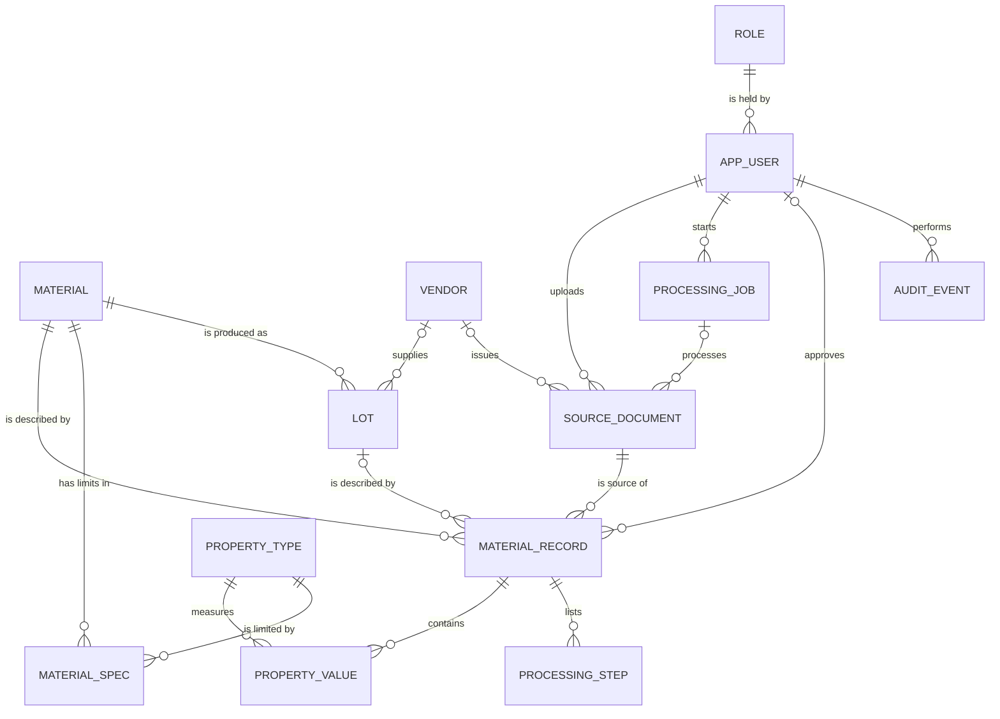
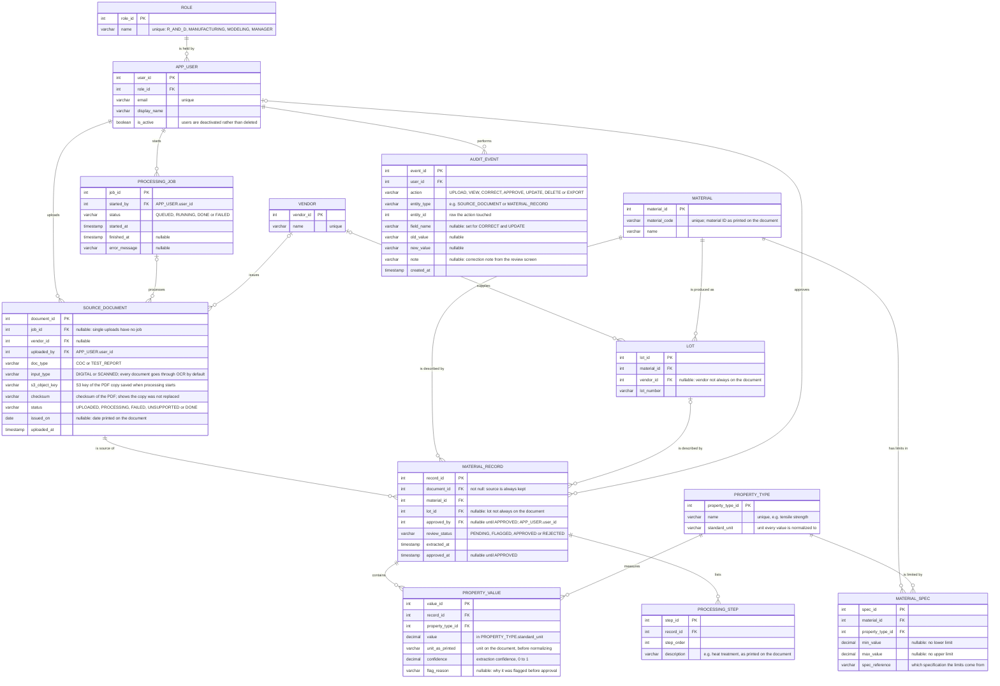

## Design -- ER Diagram
Epic: [#42](https://github.com/CPSC490-Team-Proj/CPSC490-G07-MightyMorphin/issues/42) · Stories: [#48](https://github.com/CPSC490-Team-Proj/CPSC490-G07-MightyMorphin/issues/48), [#18](https://github.com/CPSC490-Team-Proj/CPSC490-G07-MightyMorphin/issues/18), [#20](https://github.com/CPSC490-Team-Proj/CPSC490-G07-MightyMorphin/issues/20) · Tasks: [#38](https://github.com/CPSC490-Team-Proj/CPSC490-G07-MightyMorphin/issues/38), [#172](https://github.com/CPSC490-Team-Proj/CPSC490-G07-MightyMorphin/issues/172) 
Owner: Fidelis Okorie · Sprint: 2 · Status: draft

In this document, it defines the relational data model for the verified material
data described in proposal §3: "materials, mechanical properties, documents,
vendors, and lots as related records", where "every record keeps a reference
to the copy of the original PDF saved in the sponsor's AWS storage" and "each correction and approval is logged." It also
stores what the use cases in the use case diagram ([#36](https://github.com/CPSC490-Team-Proj/CPSC490-G07-MightyMorphin/issues/36)) need;
§3 maps each use case to the tables that support it. It follows the team
decisions recorded for [#78](https://github.com/CPSC490-Team-Proj/CPSC490-G07-MightyMorphin/issues/78) and the team call of
2026-11-15: Snowflake is the confirmed platform for all structured data
(extracted, pending, flagged and approved records, plus the audit log); the
PDF itself is saved to AWS S3 when processing starts, and the database keeps
only its S3 object key and checksum; only approved records count as verified
material data; and every action is logged for the Manager.

## 1. Entity-relationship diagram

### 1.1 Overview

The tables and how they connect, without their columns. This is the version
shown in the proposal (§4, Figure 2).

*Figure 1 — ER overview. Read each line end as "how many" of the table it
touches:*

| Line end | Mermaid code | Means |
|---|---|---|
| two bars | `\|\|` | exactly one |
| one bar and a circle | `\|o` | zero or one (optional: used where the vendor, lot or job may be missing from a document) |
| circle and fork (three prongs) | `o{` | zero or many |

*Example: the line from `SOURCE_DOCUMENT` (two bars) to `MATERIAL_RECORD`
(circle and fork) reads "each material record comes from exactly one
source document; a document can be the source of zero or many records."*

### 1.2 Full diagram with columns

*Figure 2 — Full ER diagram with each table's columns, keys and types.
Read it with Figure 1 for the relationships.*

## 2. Entities

| Entity | What one row is | Requirement it satisfies |
|---|---|---|
| `ROLE` | one of the four actors in the use case diagram | #36: Manage User Permissions |
| `APP_USER` | an authorized Edwards employee, signed in with Edwards' Microsoft SSO | §3: uploads, reviews and approvals are made by a user |
| `PROCESSING_JOB` | one batch of uploaded documents being processed | #36: Batch Process Documents, Monitor Processing Jobs |
| `VENDOR` | a supplier named on a CoC or test report | #18: "support vendor information when available" |
| `MATERIAL` | a material identified by its material ID | #18: "represent materials" |
| `LOT` | one production lot of a material | #18: "support lot information when available" |
| `PROPERTY_TYPE` | one kind of mechanical property and its standard unit | #18: "represent mechanical properties"; lets values and limits be compared |
| `MATERIAL_SPEC` | the allowed range of one property for one material | #36: View Material Specifications, Compare Data to Specifications, Identify Out-of-Spec Materials |
| `SOURCE_DOCUMENT` | one uploaded PDF: the S3 object key and checksum of its copy, and its processing `status` | #18: "distinguish CoCs from material test reports" (`doc_type`); #20: source identified as CoC or test report; Goal 1 spec: unsupported documents are rejected |
| `MATERIAL_RECORD` | the material data extracted from one document, with its `review_status`; only `APPROVED` rows are verified material data | #20: "each extracted material record shall retain a reference to its source document" (`document_id`, not null); #19: candidate records and review status |
| `PROPERTY_VALUE` | one mechanical property value | #18: "represent mechanical properties associated with materials"; §3 verification checks (units, confidence) |
| `PROCESSING_STEP` | one processing step printed on the document | #36: View Material Processing Info |
| `AUDIT_EVENT` | one action by a user (upload, view, correction, approval, edit, delete, export) | §3: "each correction and approval is logged"; Goal 2 spec: audit log of record operations; #36: Validate Extracted Data, Export Audit Logs |

## 3. Use case coverage

Every use case in the use case diagram (#36) maps to the tables that
hold its data. Use cases marked *derived* need no table of their own: they are
queries over tables already listed.

| Use case (#36) | Tables |
|---|---|
| Import PDF Documents | `SOURCE_DOCUMENT` (`s3_object_key`, `checksum`, `status`) |
| Batch Process Documents | `PROCESSING_JOB`, `SOURCE_DOCUMENT.job_id` |
| Extract Material Data | `SOURCE_DOCUMENT.status`; values are written to `MATERIAL_RECORD` (`review_status` PENDING or FLAGGED), `PROPERTY_VALUE` and `PROCESSING_STEP` |
| Validate Extracted Data | `MATERIAL_RECORD.review_status`, `PROPERTY_VALUE.confidence`, `AUDIT_EVENT` (corrections and approvals) |
| Import Material Records | `MATERIAL_RECORD.review_status` set to APPROVED, with `approved_by` and `approved_at` |
| Search / Filter Material Records | `MATERIAL`, `VENDOR`, `LOT`, `SOURCE_DOCUMENT.doc_type`; only APPROVED records |
| View Material Specifications | `MATERIAL_SPEC` |
| View Material Properties | `PROPERTY_VALUE`, `PROPERTY_TYPE` |
| View Material Processing Info | `PROCESSING_STEP` |
| Compare Data to Specifications | *derived*: `PROPERTY_VALUE` joined to `MATERIAL_SPEC` on material and property type |
| View Historical Material Trends | *derived*: `PROPERTY_VALUE` ordered by `SOURCE_DOCUMENT.issued_on` |
| Identify Out-of-Spec Materials | *derived*: values outside `MATERIAL_SPEC.min_value` / `max_value` |
| View Mechanical Property Ranges | *derived*: minimum and maximum of `PROPERTY_VALUE.value` per property type |
| Export Results (PDF, DOC, CSV) | *derived*: the same queries as search and compare, plus an `AUDIT_EVENT` with `action = EXPORT` |
| Manage User Permissions | `ROLE`, `APP_USER.role_id` |
| Monitor Processing Jobs | `PROCESSING_JOB`, `SOURCE_DOCUMENT.status` |
| Export Audit Logs | `AUDIT_EVENT` (Manager only; not shown in the web app) |

## 4. Relationships

1. A processed `SOURCE_DOCUMENT` produces one or more `MATERIAL_RECORD`s. Each
   `MATERIAL_RECORD` has exactly one source document, and the document holds
   the S3 object key and checksum of its PDF, so a value can always be traced
   back to the file it came from (#20, #21).
2. A `MATERIAL_RECORD` is for one `MATERIAL` and, when the document gives
   one, one `LOT`.
3. A `MATERIAL_RECORD` holds many `PROPERTY_VALUE`s and `PROCESSING_STEP`s.
   Each `PROPERTY_VALUE` is one `PROPERTY_TYPE`.
4. A `MATERIAL` has one `MATERIAL_SPEC` row per limited property. A value is
   out of spec when it falls outside the spec row with the same material and
   property type.
5. A `LOT` belongs to one `MATERIAL` and, when known, one `VENDOR`.
6. A `PROCESSING_JOB` started by one `APP_USER` processes many
   `SOURCE_DOCUMENT`s; a document uploaded on its own has no job.
7. Extracted values are written to Snowflake right away as a `MATERIAL_RECORD`
   with `review_status` PENDING, or FLAGGED when a check fails or confidence is
   below about 90% (§3). The record waits in the review queue until a user with
   permission corrects and approves it; the uploader is notified. Only APPROVED
   records are shown in search and analysis, so they are the verified material
   data. An approved record has exactly one approving `APP_USER`; a pending one
   has none yet.
8. Each `APP_USER` has one `ROLE`.
9. Every action a user takes (upload, view, correction, approval, edit,
   delete, export) is one `AUDIT_EVENT`. The audit log is not shown in the web
   app; the Manager exports it.

## 5. Key decisions

| Decision | Options considered | Chosen | Why |
|---|---|---|---|
| Storing property values | one column per property on the record · one row per property (`PROPERTY_VALUE`) | one row per property | CoCs and test reports from different vendors list different properties; a row per value needs no schema change for a new property |
| Naming properties | free-text name on each value · shared `PROPERTY_TYPE` table | `PROPERTY_TYPE` | values and spec limits must name the same property in the same unit to be compared |
| Keeping the source | file path on each property value · `document_id` on each extracted record | `document_id` on `MATERIAL_RECORD` | one reference per extracted record satisfies #20 without repeating it on every value |
| Review history | overwrite the value and keep a "reviewed" flag · log only corrections and approvals · append-only log of every action (`AUDIT_EVENT`) | log every action | team decision (#78): Edwards can trace every upload, view, change and export; the Goal 2 spec asks for an audit log of record operations |
| Database product | PostgreSQL on Amazon RDS · Snowflake | Snowflake | the sponsor already uses Snowflake (proposal §3); confirmed at the team call of 2026-11-15, after #78 had listed it as provisional |
| When extracted values are stored | store every record with a `review_status` and show only approved ones · store values only once approved | store every record with a status | team call 2026-11-15: pending and flagged values stay in Snowflake until reviewed (proposal §3); storing only approved values left the review screen with nowhere to read pending values from |
| Original PDFs | keep only a reference to Edwards' document system · store the PDF inside Snowflake · save a copy to AWS S3 | S3 copy, referenced by object key and checksum | team call 2026-11-15: the document is saved to S3 at the OCR step, and Snowflake holds only structured data; the checksum lets a reviewer prove the copy was not replaced (Goal 2 spec NFR-4) |
| Out-of-spec status | stored flag on each value · computed by comparing to `MATERIAL_SPEC` | computed | a stored flag goes stale whenever a spec limit changes |
| User permissions | one role per user · many roles per user | one role per user | each actor in the use case diagram is a separate group of users |

## 6. What is NOT designed yet

- **Final Snowflake schema and column types.** The types above are generic SQL
  types; the Snowflake tables are built in #152 and #107. Standard Snowflake
  tables record primary and foreign keys but do not enforce them (only
  `NOT NULL` is enforced), so the application must check them itself to meet
  Goal 2 spec NFR-1, which asks that keys and relationships prevent orphaned
  documents and records. How it does that is not
  designed yet.
- **Optional fields and constraints.** Which columns are required, and which
  values must be unique, depend on what real CoCs and test reports contain.
- **One database or two.** Proposal §2 and the Goal 2 spec still mention a
  separate "operational database" for candidate records. This design follows
  the team call and keeps them in Snowflake. [CONFIRM] with the team.
- **Retention, deletion and S3 lifecycle.** The Goal 2 spec asks for delete or
  deactivate "according to the defined retention policy"; that policy, how long
  the S3 copy is kept, and which bucket is used depend on the sponsor and are
  not defined yet.
- **Property names and units.** The team does not yet have real CoCs or test
  reports as mentioned above, so the rows of `PROPERTY_TYPE` are not set in stone and can be changed in the future when documents are acquired.
- **Where specification limits come from.** For `MATERIAL_SPEC` we are just assuming that Edwards
  can supply the allowed range per material and property; this is not yet
  confirmed with the sponsor with a document to confirm it.
- **What "processing info" contains.** `PROCESSING_STEP` stores it as ordered
  text until real documents show its structure.
- **Permissions per role.** `ROLE` records which group a user belongs to; the
  team will review the role list later, and what each role may do is not
  designed yet. Any Edwards employee may upload (to be confirmed with the sponsor).
- **Field-mapping tables** for vendor document formats (§3, "Handling
  different document formats").
- **Exporting results** (PDF, DOC, CSV) is in scope but planned as one of the
  last features; it needs no table of its own.
