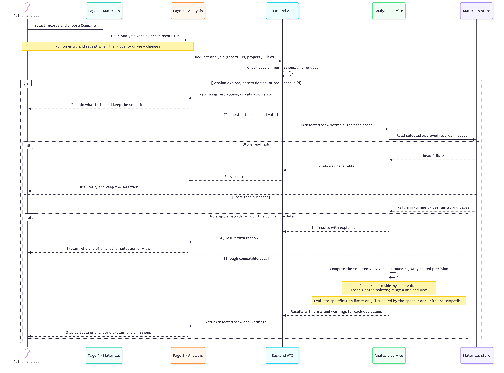
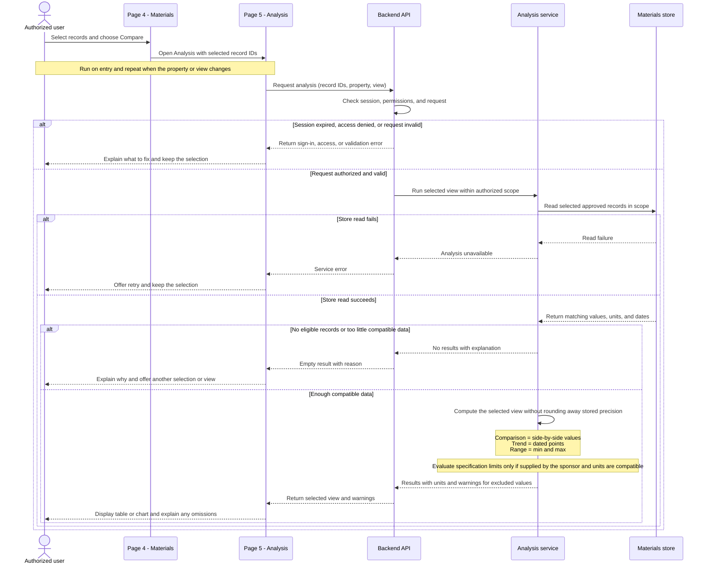

# Design — Page 5 Analysis Results Sequence

Epic: [#42](https://github.com/CPSC490-Team-Proj/CPSC490-G07-MightyMorphin/issues/42) · Story: [#48](https://github.com/CPSC490-Team-Proj/CPSC490-G07-MightyMorphin/issues/48) · Task: [#94](https://github.com/CPSC490-Team-Proj/CPSC490-G07-MightyMorphin/issues/94)

Sprint: 3 · Status: draft for teammate review

Page 4 passes selected record IDs to Page 5. Page 5 requests the active property and analysis view; the API checks authentication and permissions, and the analysis service reads only approved records the user may access. Results preserve stored precision and identify units. Trend and range views use dated points and minimum/maximum values, respectively. Unusable values are explained, never silently averaged across incompatible units. A service failure preserves the selection for retry.

This design covers FR-7, FR-8, NFR-1, NFR-2 and NFR-4 in the [analysis specification](../../specs/data-analysis-spec.md). See the [Page 5 wireframe](../ui-wireframe/ui-wireframe-analysis.png) and the [technology decision record](../technology-stack-decision.md). The diagram's **Materials store** represents **Snowflake**, the confirmed database for structured material records. API routes and unit conversion rules are not finalized. Export is deferred to later work.

Paste the Mermaid source below into a Mermaid editor to edit or re-export the diagram. The PNG above is the provided Mermaid export. Independent teammate review is pending.

