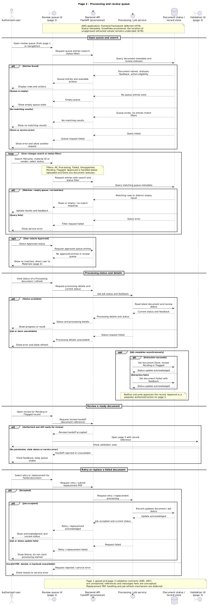

# Processing and review queue sequence diagram

Epic: [#42](https://github.com/CPSC490-Team-Proj/CPSC490-G07-MightyMorphin/issues/42) | Story: [#48](https://github.com/CPSC490-Team-Proj/CPSC490-G07-MightyMorphin/issues/48) | Task: [#92](https://github.com/CPSC490-Team-Proj/CPSC490-G07-MightyMorphin/issues/92)

Status: draft for teammate review.

*Figure: Page 2 processing and review queue interactions. The editable source is [PlantUML](sequence-review-queue.puml).*

The diagram follows the [page 2 wireframe and interaction rules](../ui-wireframe/ui-wireframe.md), the [system architecture](../system-architecture-diagram.md), and the [technology and system decisions](../technology-stack-decision.md). Document status (Uploaded, Processing, Failed, Unsupported, Done) is distinct from review status (Pending, Flagged, Approved). Done means processing finished, not that the extracted values were approved. Pending and Flagged are eligible for page 3 review subject to permission; only approval stores extracted values as approved material data. Approved records leave the review queue and are accessed in Materials (page 4). An Approved filter is included to satisfy task #92; it returns no queue entries rather than implying approved records remain in the queue.

The store lifeline represents document and status metadata, not a decision about where unapproved extracted values are held. Snowflake and FastAPI remain provisional. React versus Vue, the extraction tool, search implementation, and storage of unapproved values remain undecided under #78. Original PDFs remain in Edwards' document system, with sponsor confirmation pending; replacement handling and refresh transport are not yet specified. The page 1 upload and page 3 review interfaces ([#85](https://github.com/CPSC490-Team-Proj/CPSC490-G07-MightyMorphin/issues/85), [#87](https://github.com/CPSC490-Team-Proj/CPSC490-G07-MightyMorphin/issues/87)) are conceptual until those diagrams define their contracts. The status/feedback and available actions shown are logical responses, not finalized API schemas.

Generate the PNG from the source with PlantUML, for example `java -jar plantuml.jar -tpng sequence-review-queue.puml` from this directory. The source and image should be regenerated together after edits. AI-assisted draft; a teammate must review the diagram and unresolved dependencies before the task is considered complete.