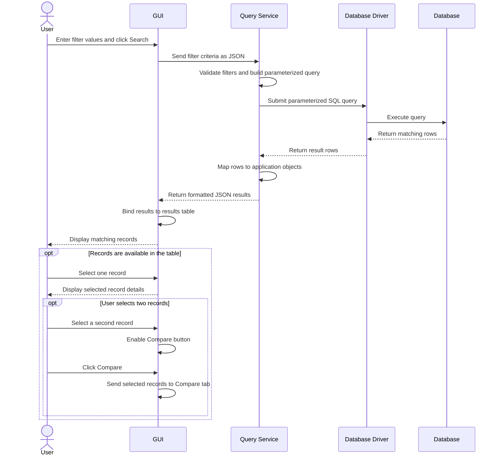

## Sequence Diagram -- Search and View Material Records
Task: [#89](https://github.com/CPSC490-Team-Proj/CPSC490-G07-MightyMorphin/issues/89) · Stories: [#24](https://github.com/CPSC490-Team-Proj/CPSC490-G07-MightyMorphin/issues/24) 
Owner: Liam Wilson · Sprint: 3 · Status: draft 

*Figure 6.4. Search, View, and Record Selection Sequence Diagram. The figure shows how a user searches for records by entering filter criteria in the GUI. The request is sent through the Query Service and Database Driver to retrieve matching database records, which are returned and displayed in a results table. Users can select a record to view its details or select two records, enabling the Compare button and passing the selected records to the Compare tab.*

## What the diagram shows
The user enters filter values and clicks Search. The GUI sends the filter criteria to the Query Service, which validates the inputs, creates a parameterized SQL query, and requests the results through the Database Driver. The database returns matching records, which are converted into application objects and returned to the GUI as formatted JSON. The GUI displays the records in a results table.

Once records are displayed, the user can select a record to view its details. The user may also select two records; when two records are selected, the GUI enables the Compare button. Clicking Compare sends the selected records to the Compare tab for comparison.