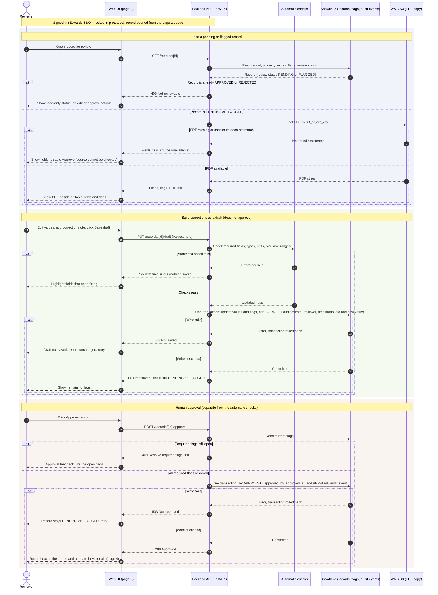

# Validate extracted information sequence diagram

Epic: [#42](https://github.com/CPSC490-Team-Proj/CPSC490-G07-MightyMorphin/issues/42) · Stories: [#48](https://github.com/CPSC490-Team-Proj/CPSC490-G07-MightyMorphin/issues/48), [#16](https://github.com/CPSC490-Team-Proj/CPSC490-G07-MightyMorphin/issues/16) · Task: [#87](https://github.com/CPSC490-Team-Proj/CPSC490-G07-MightyMorphin/issues/87) · Prototype: [#88](https://github.com/CPSC490-Team-Proj/CPSC490-G07-MightyMorphin/issues/88) 
Owner: Fidelis Okorie · Sprint: 4 · Status: draft for teammate review

This diagram shows page 3 of the [wireframe](../ui-wireframe/ui-wireframe.md)
("Validate extracted information"): a reviewer opens a pending or flagged
record from the review queue, compares the extracted values with the original
PDF, saves corrections as a draft, and approves the record once every required
flag is resolved. It follows the [system architecture](../system-architecture-diagram.md),
the [ER diagram](../er-diagram.md) and the [technology and system decisions](../technology-stack-decision.md) (#78).

*Figure: Page 3 validation and approval interactions. The editable source is the Mermaid block below.*

## How to read it

- **Three flows.** Loading (steps in the blue box), saving a draft (green) and
  approving (orange). Each `alt` block is a decision; the first branch is the
  error or edge case, the second the normal path.
- **Automatic checks are not approval.** The automatic checks run on every
  save and only update flags. A record becomes approved only when a reviewer
  clicks Approve and no required flag is open. Saving a draft never changes the
  review status.
- **Failed saves never approve.** Every write is one Snowflake transaction. If
  it fails, it is rolled back and the record keeps its previous values and its
  PENDING or FLAGGED status. The API never reports success before the commit.
- **Review history.** Each correction and the approval are stored as
  `AUDIT_EVENT` rows with the reviewer and a timestamp, as in the
  [ER diagram](../er-diagram.md). The history is kept for the Manager; it is not
  shown as a user-facing panel on page 3.
- **Source must be checkable.** If the PDF copy is missing or its checksum does
  not match `SOURCE_DOCUMENT.checksum`, the reviewer still sees the values but
  cannot approve, because the values cannot be compared with their source.

## Decisions and alternatives

| Decision | Chosen | Rejected | Why |
|---|---|---|---|
| When the automatic checks run | On every draft save, and the approve step re-reads the flags | Only once, after extraction | Corrections can create new problems (wrong unit, out-of-range value); re-checking keeps the flags true |
| Draft vs approve | Two separate actions | One "Save and approve" button | The wireframe and interaction rules say "Saving a draft does not approve it" |
| Write failure handling | Whole change in one transaction, rolled back on error | Write values first, then status | A partial write could leave a record approved with old values, or corrected with no history |
| Approve with open flags | Refused (409) with the list of open flags | Allow with a warning | Interaction rules: "Required flags must be resolved before approval" |

## Not designed yet

- **Authentication and permissions.** Edwards Microsoft SSO and which roles may
  approve are not designed; the prototype ([#88](https://github.com/CPSC490-Team-Proj/CPSC490-G07-MightyMorphin/issues/88)) uses a fixed demo reviewer.
- **Re-extract / replace.** The wireframe's Re-extract / replace button hands
  the document back to processing (page 2, [#92](https://github.com/CPSC490-Team-Proj/CPSC490-G07-MightyMorphin/issues/92)); that hand-off is not shown here.
- **Reject.** The ER diagram allows a REJECTED status, but page 3 has no reject
  action yet and who may reject is undecided.
- **Exact API shapes.** Paths and status codes are the prototype's; request and
  response schemas are not final. FastAPI is still provisional under #78, and
  the front-end framework (React or Vue) is deferred.
- **PDF delivery.** Whether the API streams the PDF or hands out a short-lived
  S3 link is not decided, and the S3 bucket depends on the sponsor.
- **Confidence aggregation.** How the three OCR passes combine into one
  confidence value, and the exact threshold (about 90%), remain open.

The PNG is rendered from the Mermaid block above (Mermaid 10.9.1); regenerate
both together after any edit. AI-assisted draft; a teammate must review the
diagram against the wireframe and requirements before #87 is complete.
