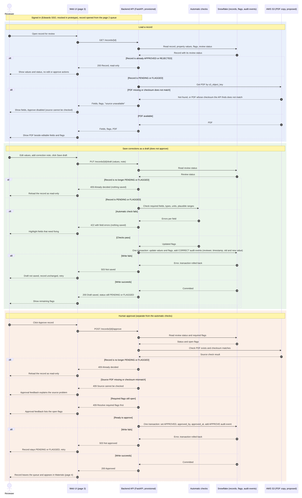
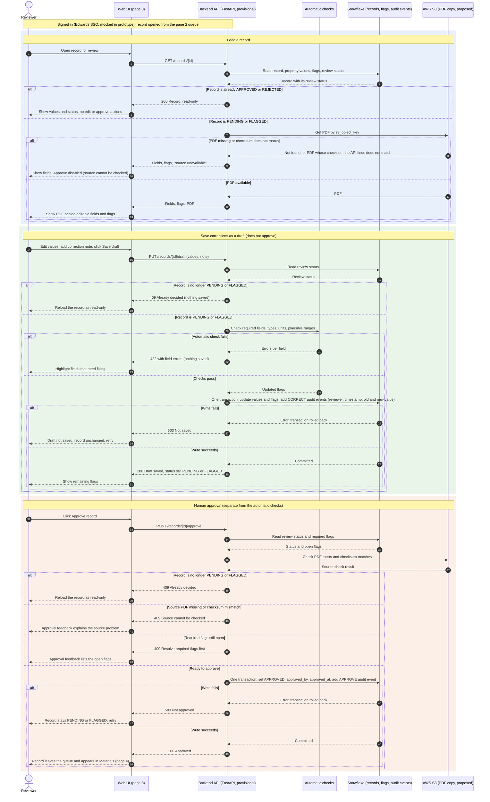

# Validate extracted information sequence diagram

Epic: [#42](https://github.com/CPSC490-Team-Proj/CPSC490-G07-MightyMorphin/issues/42) · Stories: [#48](https://github.com/CPSC490-Team-Proj/CPSC490-G07-MightyMorphin/issues/48), [#16](https://github.com/CPSC490-Team-Proj/CPSC490-G07-MightyMorphin/issues/16) · Task: [#87](https://github.com/CPSC490-Team-Proj/CPSC490-G07-MightyMorphin/issues/87) · Prototype: [#88](https://github.com/CPSC490-Team-Proj/CPSC490-G07-MightyMorphin/issues/88) · Specification: [Goal 1](../../specs/goal-1-snowflake-ingestion-validation.md) 
Owner: Fidelis Okorie · Sprint: 4 · Status: draft for teammate review

This diagram shows page 3 of the [wireframe](../ui-wireframe/ui-wireframe.md)
("Validate extracted information"): a reviewer opens a pending or flagged
record from the review queue, compares the extracted values with the original
PDF, saves corrections as a draft, and approves the record once every required
flag is resolved.

It uses the components of the [system architecture](../system-architecture-diagram.md),
which reflects the November 15 team-call decisions: Snowflake is the confirmed
platform for structured data, and the PDF processing copy is kept in AWS storage
(an S3 bucket is proposed). The architecture's Data review module is shown here
as part of the Backend API. Two interactions are new in this diagram and are not
drawn in the architecture figure: the backend reads the PDF copy back from S3 so
the reviewer can see it, and the automatic checks run again when a draft is
saved. The [technology and system decisions](../technology-stack-decision.md)
(#78) still list FastAPI as provisional and the front-end framework as deferred;
its "Original PDFs" row predates the November 15 call and still describes the
earlier document-system choice. Field and status names
(`MATERIAL_RECORD.review_status`, `REJECTED`, `SOURCE_DOCUMENT.s3_object_key`
and `checksum`) follow the [ER diagram](../er-diagram.md) as updated for
[#172](https://github.com/CPSC490-Team-Proj/CPSC490-G07-MightyMorphin/issues/172).

*Figure: Page 3 validation and approval interactions. The editable source is the Mermaid block below.*

## How to read it

- **Three flows.** Loading (blue), saving a draft (green) and approving
  (orange). Each `alt` block is a decision; the last branch is the normal path
  and the earlier branches are the error or edge cases.
- **Automatic checks are not approval.** The automatic checks run on every
  draft save and only update flags. A record becomes approved only when a
  reviewer clicks Approve and the backend confirms the record is still pending
  or flagged, its source PDF can be checked, and no required flag is open.
  Saving a draft never changes the review status.
- **The backend enforces every rule.** The screen disables Approve when the
  source is unavailable, but the backend repeats the status, source and flag
  checks on every approve request, so a stale page or a second browser tab
  cannot approve a record that should not be approved.
- **Failed saves never approve.** Every write is one Snowflake transaction. If
  it fails, it is rolled back and the record keeps its previous values and its
  PENDING or FLAGGED status. The API never reports success before the commit.
- **Review history.** Each correction and the approval are stored as
  `AUDIT_EVENT` rows with the reviewer and a timestamp, as in the
  [ER diagram](../er-diagram.md). The history is kept for the Manager; it is not
  shown as a user-facing panel on page 3.

## Decisions and alternatives

| Decision | Chosen | Rejected | Why |
|---|---|---|---|
| When the automatic checks run | On every draft save, and the approve step re-reads the flags | Only once, after extraction | Corrections can create new problems (wrong unit, out-of-range value); re-checking keeps the flags true |
| Draft vs approve | Two separate actions | One "Save and approve" button | The wireframe and interaction rules say "Saving a draft does not approve it" |
| Write failure handling | Whole change in one transaction, rolled back on error | Write values first, then status | A partial write could leave a record approved with old values, or corrected with no history |
| Approve with open flags | Refused (409) with the list of open flags | Allow with a warning | Interaction rules: "Required flags must be resolved before approval" |
| Approve when the source PDF is missing or altered | Refused (409); the screen also disables Approve | Approve from the extracted values alone | Review means comparing values with their source; the Goal 2 specification keeps a checksum so users can verify the stored PDF "has not been silently replaced" (NFR-4) |
| Where the rules are enforced | In the backend on every request; the screen only mirrors them | Only in the screen | A stale page, a second tab or a direct API call would otherwise bypass the checks |
| Records already approved or rejected | Opened read-only; draft and approve requests return 409 | Allow editing on page 3 | Prevents a finished record from being changed or approved twice |

## Not designed yet

- **Authentication and permissions.** Edwards Microsoft SSO and which roles may
  approve are not designed; the prototype ([#88](https://github.com/CPSC490-Team-Proj/CPSC490-G07-MightyMorphin/issues/88)) will use a fixed demo reviewer.
- **Reject.** Rejecting a record is required: feature [#162](https://github.com/CPSC490-Team-Proj/CPSC490-G07-MightyMorphin/issues/162)
  asks that reviewers "approve or reject" candidate records, and the Goal 2
  specification (FR-5) stores "the approval or rejection decision". The ER
  diagram already has a REJECTED status, but the reject action, its screen
  control and who may reject are deferred.
- **Re-extract / replace.** What happens after the wireframe's Re-extract /
  replace button is not designed here. The page 2 diagram ([#92](https://github.com/CPSC490-Team-Proj/CPSC490-G07-MightyMorphin/issues/92)) covers
  retrying or replacing *Failed* documents only, and defers replacement handling.
- **Exact API shapes.** Paths and status codes are proposed for the prototype;
  request and response schemas are not final. FastAPI is still provisional
  under #78, and the front-end framework (React or Vue) is deferred.
- **PDF delivery.** Whether the API streams the PDF or hands out a short-lived
  S3 link is not decided, and the S3 bucket depends on the sponsor.
- **Concurrent reviewers.** The status checks stop a record from being approved
  twice, but how two reviewers editing the same draft at once are handled is
  not designed.
- **Confidence aggregation.** How the three OCR passes combine into one
  confidence value, and the exact threshold (about 90%), remain open.

The PNG is rendered from the Mermaid block above (Mermaid 10.9.1).
