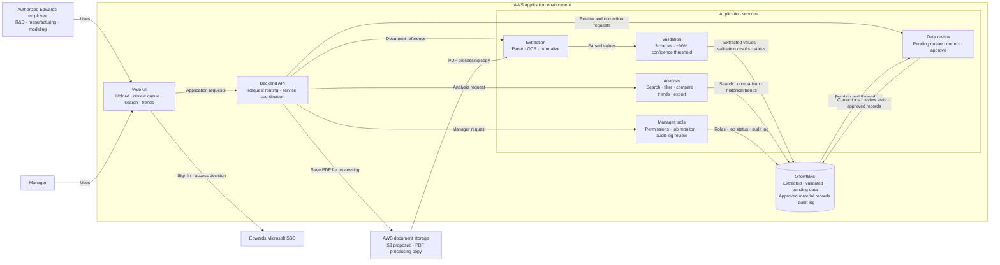

> Epic: [#42](https://github.com/CPSC490-Team-Proj/CPSC490-G07-MightyMorphin/issues/42) · Story: [#48](https://github.com/CPSC490-Team-Proj/CPSC490-G07-MightyMorphin/issues/48) · Task: [#39](https://github.com/CPSC490-Team-Proj/CPSC490-G07-MightyMorphin/issues/39)
> Owner: Bhavesh Malhi · Sprint: 2 · Status: draft

# System Architecture Diagram

This architecture shows the application components and their communication after the November 15 team-call decisions. Snowflake is the confirmed platform for ingesting, storing, and analyzing structured material data. Digital or already-scanned PDFs are staged in AWS storage (an S3 bucket is proposed) for OCR; physical scanning is outside the system. Extracted, validated, pending, and flagged data are tracked in Snowflake, while only approved values become approved material records. Each document is checked three times; results below approximately 90% confidence are flagged. The extraction product and S3 lifecycle details remain undecided. A Manager can inspect audit logs to investigate failures.

## Component Responsibilities

| Component | Responsibility |
|---|---|
| Web UI | Lets authorized users upload documents, review and correct extracted records, search and filter materials, compare records, view historical trends, and export results. |
| Backend API | Routes UI requests and coordinates authentication, document references, extraction, and data access. |
| Extraction module | Reads the PDF processing copy from AWS storage, runs the selected OCR/extraction tool, normalizes fields, and passes structured values to validation. Physical scanning is outside the application workflow. |
| Validation module | Checks each document three times against the configured rules. Results below approximately 90% confidence are marked Flagged; the exact scoring method and threshold calibration remain to be designed. |
| Data review module | Reads pending and flagged records from Snowflake, lets an authorized user correct values, and writes review status and corrections back to Snowflake. Only approved values become approved material records. |
| Analysis module | Queries approved Snowflake material data for search, filtering, comparisons, historical trends, and export (PDF, DOC, CSV; planned last). |
| Manager tools | Allow a Manager to manage permissions, monitor processing jobs, and inspect audit logs to investigate failures. |
| Snowflake | Stores extracted, validated, pending, and flagged data; approved material records; document references; and audit events. It is the confirmed platform for structured material-data ingestion, storage, and analysis. |
| AWS document storage | Holds the PDF processing copy used by OCR; an S3 bucket is proposed. Original-file retention, lifecycle, and integration details remain to be decided. |
| Edwards Microsoft SSO | Signs users in with their Edwards Microsoft account and provides access decisions. |

*High-level system architecture. PDFs are staged in proposed AWS/S3 storage for extraction; Snowflake tracks extracted and review-state data, while only approved values become material records. Three validation checks and an approximately 90% confidence threshold determine whether a document is flagged. Extraction tooling, PDF lifecycle, and role permissions beyond the Manager workflow remain to be designed.*
