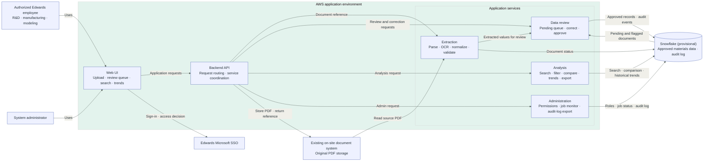

> Epic: [#42](https://github.com/CPSC490-Team-Proj/CPSC490-G07-MightyMorphin/issues/42) · Story: [#48](https://github.com/CPSC490-Team-Proj/CPSC490-G07-MightyMorphin/issues/48) · Task: [#39](https://github.com/CPSC490-Team-Proj/CPSC490-G07-MightyMorphin/issues/39)
> Owner: Bhavesh Malhi · Sprint: 2 · Status: draft

# System Architecture Diagram

This architecture shows the planned application components and their communication. The application is hosted in AWS, Snowflake is the provisional materials data platform (the team is still trying it out, #78), and original PDFs remain in Edwards' existing on-site document system; the application keeps only a reference to each PDF. Users sign in with Edwards' Microsoft SSO. Extracted values reach Snowflake only after a user approves them, and every user action is written to an audit log that only the administrator can export.

## Component Responsibilities

| Component | Responsibility |
|---|---|
| Web UI | Lets authorized users upload documents, review and correct extracted records, search and filter materials, compare records, view historical trends, and export results. |
| Backend API | Routes UI requests and coordinates authentication, document references, extraction, and data access. |
| Extraction module | Reads source PDFs from the on-site document system, runs OCR on every document by default, normalizes and validates fields, records each document's status (Uploaded, Processing, Failed, Unsupported, Done), and passes the extracted values to review. |
| Data review module | Presents pending and flagged documents for human review, lets a user with permission correct values, notifies the uploader when a document is not approved, and writes the values to Snowflake only on approval. |
| Analysis module | Queries approved material data for search, filtering, comparisons, historical trends, and export (PDF, DOC, CSV; planned last). |
| Administration module | Lets the system administrator manage permissions, monitor processing jobs, and export the audit log, which is not shown anywhere else in the web app. |
| Snowflake (provisional) | Stores approved material records, document status, and the audit log of every user action; supports application queries and analysis. Final choice pending the team's Snowflake trial (#78). |
| Existing on-site document system | Stores original PDFs and serves them to the application by document reference; Edwards keeps responsibility for storing and securing them. |
| Edwards Microsoft SSO | Signs users in with their Edwards Microsoft account and provides access decisions. |

*High-level system architecture. Original PDF files stay in the existing on-site document system; extracted values wait in the review queue and reach Snowflake only after approval, and historical trends are queried from Snowflake.*
