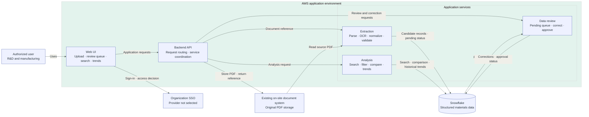

> Epic: [#42](https://github.com/CPSC490-Team-Proj/CPSC490-G07-MightyMorphin/issues/42) · Story: [#48](https://github.com/CPSC490-Team-Proj/CPSC490-G07-MightyMorphin/issues/48) · Task: [#39](https://github.com/CPSC490-Team-Proj/CPSC490-G07-MightyMorphin/issues/39)
> Owner: Bhavesh Malhi · Sprint: 2 · Status: draft

# System Architecture Diagram

This architecture shows the planned application components and their communication. The application is assumed to run in AWS, Snowflake is the materials data platform, and original PDFs remain in the organization's existing on-site document system. The SSO provider is shown as an external dependency; its specific product is not selected here.

## Component Responsibilities

| Component | Responsibility |
|---|---|
| Web UI | Lets authorized users upload documents, review and correct extracted records, search and filter materials, compare records, and view historical trends. |
| Backend API | Routes UI requests and coordinates authentication, document references, extraction, and data access. |
| Extraction module | Reads source PDFs from the on-site document system, parses digital PDFs or applies OCR when needed, normalizes and validates fields, and submits candidate records for review. |
| Data review module | Presents pending extracted records for human review, persists corrections and approval status, and preserves review history. |
| Analysis module | Queries structured material data for search, filtering, comparisons, and historical trend monitoring. |
| Snowflake | Stores candidate and approved material records, review status, and history; supports application queries and analysis. |
| Existing on-site document system | Stores original PDFs and serves them to the application by document reference. |
| Organization SSO | Provides authentication and access decisions; the specific identity provider remains unspecified. |

*Figure 3 — High-level system architecture. Original PDF files stay in the existing on-site document system; extracted records enter a review queue before approval, and historical trends are queried from Snowflake.*
