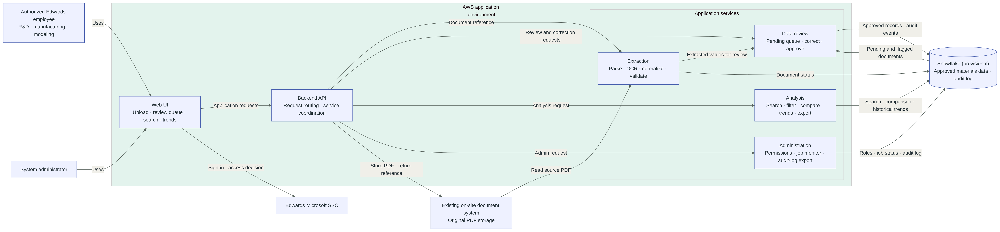

## Design -- Technology Stack and System Decisions
> Epic: [#42](https://github.com/CPSC490-Team-Proj/CPSC490-G07-MightyMorphin/issues/42) · Story: [#48](https://github.com/CPSC490-Team-Proj/CPSC490-G07-MightyMorphin/issues/48) · Feature: [#78](https://github.com/CPSC490-Team-Proj/CPSC490-G07-MightyMorphin/issues/78)
> Owner: Fidelis Okorie · Sprint: 3 · Status: draft

This record settles where the team's documents disagreed about the system. The
environment table from [#47](https://github.com/CPSC490-Team-Proj/CPSC490-G07-MightyMorphin/issues/47)
(merged in PR [#75](https://github.com/CPSC490-Team-Proj/CPSC490-G07-MightyMorphin/pull/75))
listed PostgreSQL on Amazon RDS, Amazon S3 and Textract/Tesseract, while the
system architecture (PR [#72](https://github.com/CPSC490-Team-Proj/CPSC490-G07-MightyMorphin/pull/72))
used Snowflake and Edwards' existing document system. The use case, ER, data
flow and UI wireframe documents also differed on roles, statuses and the review
flow. The team voted on each difference in Sprint 3; this document records the
result. Every design document in `docs/design/` now follows it.

Each choice is marked:

- **Selected**: agreed by the team; the design documents use it.
- **Provisional**: the documents use it, but it can still change after the
  check named in the table.
- **Deferred**: not chosen yet; the documents leave it open.

*The architecture after these decisions: the application runs in AWS, users sign
in with Edwards' Microsoft SSO, original PDFs stay in Edwards' document system,
and Snowflake (provisional) holds approved material data and the audit log.*

## 1. Technology

| Area | Decision | Status | Alternatives considered | Why |
|---|---|---|---|---|
| Hosting | The application (web UI, backend API, services) runs in AWS | Selected | On-site Edwards servers | The proposal (§0, Objective 2.2) already commits to AWS, and the team builds outside Edwards IT |
| Material database | Snowflake stores, ingests and analyzes the material data | Provisional: the team must try Snowflake before confirming | PostgreSQL on Amazon RDS (#75) | Edwards already uses and supports Snowflake (proposal §3), so the data would stay in the sponsor's environment |
| Original PDFs | Stay in Edwards' existing document system; the application stores only a reference to each PDF | Selected; sponsor confirmation pending | Copy every PDF into Amazon S3 (#75) | Edwards already stores the documents and handles their security; a second copy would duplicate storage and security work |
| Sign-in | Edwards' Microsoft SSO (company email) | Selected; sponsor confirmation pending | An unnamed SSO provider (#72); our own accounts | Users already have Edwards Microsoft accounts; the Goal 3 specification assumes them |
| Backend | FastAPI (Python) | Provisional: kept from #75, not re-voted | — | Python is also the extraction language, so one language covers both |
| Frontend | React or Vue | Deferred | React, Vue | Not voted on yet |
| Extraction tool | Every document goes through OCR by default; the tool is not chosen | Deferred | Snowflake document AI (proposal §3), Amazon Textract, Tesseract (#75) | Depends on the Snowflake trial and on having sample documents |

**Where a PDF lives.** The permanent original stays in Edwards' document system.
The extraction step reads it by reference. If the chosen extraction tool needs a
working copy, that copy is temporary and only exists during processing; it is
not a second permanent store. How that copy is handled is deferred until the
extraction tool is chosen.

## 2. System behavior

| Area | Decision | Status |
|---|---|---|
| User roles | R&D, Manufacturing, Modeling, System Administrator (as in the use case and ER diagrams) | Deferred: the team will review the role list |
| Who uploads | Any Edwards employee can upload PDFs | Selected; sponsor confirmation pending |
| How documents enter | Users upload PDFs in the web app; paper documents are scanned to PDF first; every PDF goes through OCR | Selected |
| Flagged records | A user with permission corrects the values against the PDF, then approves; the document can also be re-extracted or re-scanned | Selected |
| What gets stored | Extracted values enter the database only after approval. A document that is not approved stays in the review queue with a reference to its PDF, the uploader is notified, and it waits until it is approved | Selected |
| Status names | Documents: Uploaded, Processing, Failed, Unsupported, Done. Review: Pending, Flagged, Approved | Selected |
| Search | Whether search reads Snowflake directly or through a separate filtering step | Deferred |
| Export | Users can export results as PDF, DOC or CSV; built as one of the last features | Selected (scheduled last) |
| Audit log | Every user action (upload, view, correction, approval, edit, delete, export) is logged; only the System Administrator can export the log, and it is not shown elsewhere in the web app | Selected |

## 3. Open items

| Item | Owner | Needed by |
|---|---|---|
| Try Snowflake and confirm it as the material database | Team | Sprint 4 planning, Nov 17 |
| Confirm with Edwards: PDFs stay in their document system, Microsoft SSO, any employee can upload | Team (the lead emails the mentor, professor cc'd) | Sprint 4 planning, Nov 17 |
| Choose the extraction tool | Team | After the Snowflake trial |
| Choose React or Vue | Team | Before the web app prototype pages need it |
| Review the role list | Team | Sprint 4 |
| Decide how search reads the data | Team | Before the search prototype page (#90) |
| Decide where extracted values wait during review | Team | Before the validation prototype page (#88) |

## 4. What changed because of this record

- **Design documents** (all in `docs/design/`): use case, ER, system architecture,
  data flow and UI wireframe now use the roles, statuses, storage, sign-in and
  review flow above, and their exported images match.
- **Proposal §4**: the environment table and the Figure 3 description now match
  this record.
- **Specifications**: the Goal 1–3 specifications already agree with the
  decisions above; no change was needed.

## 5. What is NOT decided yet

Everything marked **Deferred** above, plus the data retention policy that the
Goal 2 specification refers to. Sponsor confirmations are still pending for the
PDF location, Microsoft SSO and who may upload; until Edwards answers, those
choices stand as the team's working assumptions.
