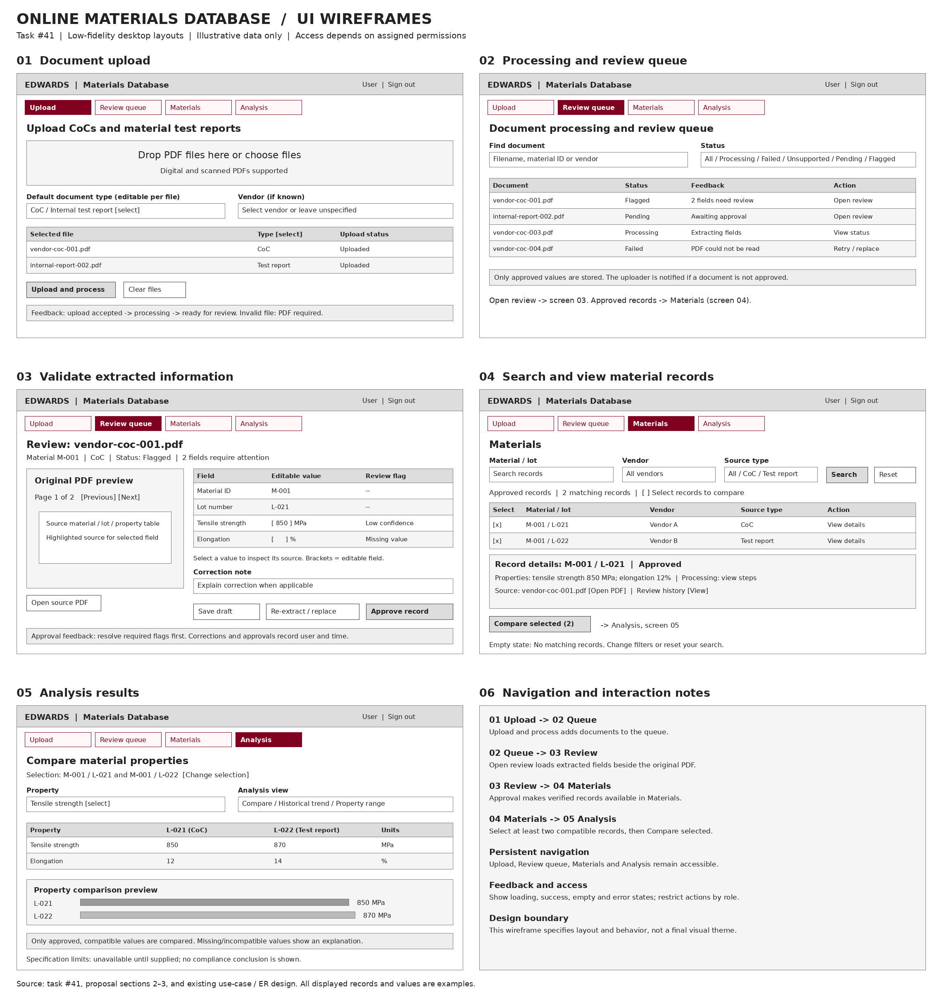

# UI wireframes — Online Materials Database

Task: [#41](https://github.com/CPSC490-Team-Proj/CPSC490-G07-MightyMorphin/issues/41) · Status: draft for team review

The layouts illustrate desktop screens for authorized Edwards users. All names, records and property values are examples. Navigation and permissions are conceptual; the screens are static wireframes.

## Acceptance criteria coverage

| [Task #41](https://github.com/CPSC490-Team-Proj/CPSC490-G07-MightyMorphin/issues/41) criterion | Coverage |
|---|---|
| Document upload | Screen 01: digital/scanned PDFs, batch selection, document type per file, vendor, processing action and feedback |
| Review and validation | Screens 02–03: processing status, flagged/pending queue, source preview, editable extracted fields, correction note, approval and review history |
| Search and stored records | Screen 04: material/lot, vendor and source-type filters, results, property details, source PDF and history |
| Analysis results | Screen 05: selected-record comparison, values and units, chart placeholder, trend/range view selection and missing-data feedback |
| Navigation | Persistent navigation on every screen; overview panel 06 describes transitions |
| Inputs, buttons, tables and feedback | Included across all primary screens, with invalid-file, failed-processing, unresolved-review and empty-search examples |
| Use cases and functional requirements | Covers import/batch processing, extraction review, search/filter, properties, source documents and comparison; trends/ranges are view choices. Specification comparisons remain conditional on sponsor-supplied limits. |
| Repository deliverable | [Overview PNG](../ui-wireframe.png) is kept at the path specified by task #41. |

## Interaction rules

- Upload accepts PDFs; the user can override document type for each selected file. Vendor is optional and may be refined during review.
- Failed documents can be retried or replaced. Document statuses are Uploaded, Processing, Failed, Unsupported and Done; review statuses are Pending, Flagged and Approved. Extracted values are stored only after approval; until then the document stays in the review queue and the uploader is notified.
- Review displays extracted values alongside the original document. Saving a draft does not approve it. Required flags must be resolved before approval; corrections and approvals retain the user and timestamp.
- The example PDF has two attention fields. After correction and approval, its illustrative material record appears in the Materials screen.
- Viewing a result opens its detail region. Comparing selected records transfers the selection to Analysis. Normal search and analysis use approved records.
- Users sign in with Edwards' Microsoft SSO. Any employee may upload (to be confirmed with the sponsor); role permissions determine the other actions, and the role list will be reviewed later. Admin tasks (permissions, job monitoring, audit-log export) are not part of these user screens.
- The on-site document system provides source PDFs through application access; the application stores only a reference. No cloud database or infrastructure configuration appears in these user screens.
- The wireframe does not assume that specification limits have been supplied. Out-of-spec conclusions require those limits and compatible units.

- Export of results (PDF, DOC, CSV) is in scope but planned last, so no export button is drawn yet.

## Editable source and individual screens

- [Editable SVG](ui-wireframe.svg): edit text and shapes in a vector editor.
- [Upload](ui-wireframe-upload.png)
- [Processing/review queue](ui-wireframe-review-queue.png)
- [Validation](ui-wireframe-validation.png)
- [Stored records](ui-wireframe-materials.png)
- [Analysis](ui-wireframe-analysis.png)

`build_wireframe.py` regenerates the PNG, SVG and individual screen exports using Python with Pillow and Arial, DejaVu Sans or Liberation Sans fonts. Edit the SVG directly or change the generator; regenerating replaces manual SVG edits.

## Design provenance

Based on task #41, proposal sections 2–3, and the use-case and ER documents inspected during this review. AI-assisted draft: layouts, example content, source and exports were generated with Codex and visually checked. Team review against the latest repository requirements is still needed before submission.

## Figma editing

Drag the five SVG screens from `figma-wireframes/` onto a Figma Design canvas,
or extract them from [the SVG package](ui-wireframe-figma.zip). No plugin is needed.
SVG import creates vector layers; font/text conversion depends on Figma.
Auto Layout and prototype links are not included. Run `prepare_figma.py`
after regenerating the main SVG to refresh the separate screens and ZIP.
