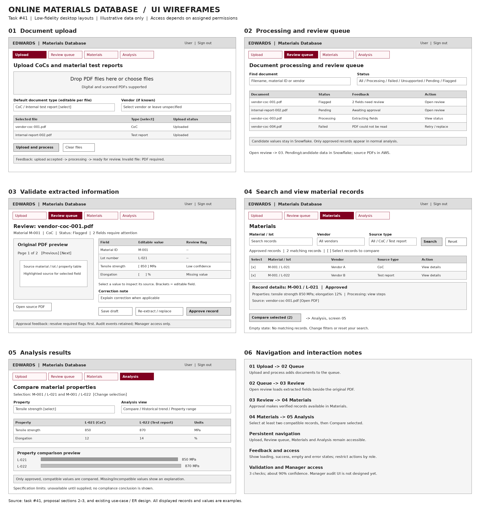

# UI wireframes — Online Materials Database

Task: [#41](https://github.com/CPSC490-Team-Proj/CPSC490-G07-MightyMorphin/issues/41) · Status: draft for team review

The layouts illustrate desktop screens for authorized Edwards users. All names, records and property values are examples. Navigation and permissions are conceptual; the screens are static wireframes.

## Acceptance criteria coverage

| [Task #41](https://github.com/CPSC490-Team-Proj/CPSC490-G07-MightyMorphin/issues/41) criterion | Coverage |
|---|---|
| Document upload | Screen 01: digital/scanned PDFs, batch selection, document type per file, vendor, processing action and feedback |
| Review and validation | Screens 02–03: processing status, flagged/pending queue, source preview, editable extracted fields, correction note and approval |
| Search and stored records | Screen 04: material/lot, vendor and source-type filters, results, property details and source PDF |
| Analysis results | Screen 05: selected-record comparison, values and units, chart placeholder, trend/range view selection and missing-data feedback |
| Navigation | Persistent navigation on every screen; overview panel 06 describes transitions |
| Inputs, buttons, tables and feedback | Included across all primary screens, with invalid-file, failed-processing, unresolved-review and empty-search examples |
| Use cases and functional requirements | Covers import/batch processing, extraction review, search/filter, properties, source documents and comparison; trends/ranges are view choices. Specification comparisons remain conditional on sponsor-supplied limits. |
| Repository deliverable | [Overview PNG](../ui-wireframe.png) is kept at the path specified by task #41. |

## Interaction rules

- Upload accepts PDFs; the user can override document type for each selected file. Vendor is optional and may be refined during review.
- Users upload existing digital/scanned PDFs; the app performs no physical scanning. At OCR processing the PDF is saved to AWS (S3 proposed). Candidate data, pending review items, validation results and approved material data are held in Snowflake, with status separating them. Documents: Uploaded, Processing, Failed, Unsupported, Done; review: Pending, Flagged, Approved.
- Review displays extracted values alongside the original document. Saving a draft does not approve it. Required flags must be resolved before approval; corrections and approvals retain the user and timestamp.
- The example PDF has two attention fields. After correction and approval, its illustrative material record appears in the Materials screen.
- Viewing a result opens its detail region. Comparing selected records transfers the selection to Analysis. Normal search and analysis use approved records.
- Users sign in with Edwards' Microsoft SSO. Any employee may upload (to be confirmed with the sponsor); role permissions determine the other actions, and the role list will be reviewed later. Manager tasks (permissions, job monitoring, audit-log access/export) are not part of these user screens.
- Source PDFs are retrieved through authorized application access to AWS storage. Regular user screens do not display the audit log; the Manager can access it for investigation.
- Validation checks each document three times, using approximately 90% confidence as the working team threshold. Below-threshold results are flagged; the aggregation rule and exact threshold remain to be specified.
- The wireframe does not assume that specification limits have been supplied. Out-of-spec conclusions require those limits and compatible units.

- Export of results (PDF, DOC, CSV) is in scope but planned last, so no export button is drawn yet.

## Editable source and individual screens

- [Editable SVG](ui-wireframe.svg): edit text and shapes in a vector editor.
- [Upload](ui-wireframe-upload.png)
- [Processing/review queue](ui-wireframe-review-queue.png)
- [Validation](ui-wireframe-validation.png)
- [Stored records](ui-wireframe-materials.png)
- [Analysis](ui-wireframe-analysis.png)

`build_wireframe.py` regenerates the PNG, SVG and individual screen exports using Python with Pillow and Arial, DejaVu Sans or Liberation Sans fonts. Edit the SVG directly or change the generator; regenerating replaces manual SVG edits.

## Design provenance

Based on task #41, proposal sections 2–3, and the use-case and ER documents inspected during this review. AI-assisted draft: layouts, example content, source and exports were generated with Codex and visually checked. Team review against the latest repository requirements is still needed before submission.

## Figma editing

Drag the five SVG screens from `figma-wireframes/` onto a Figma Design canvas,
or extract them from [the SVG package](ui-wireframe-figma.zip). No plugin is needed.
SVG import creates vector layers; font/text conversion depends on Figma.
Auto Layout and prototype links are not included. Run `prepare_figma.py`
after regenerating the main SVG to refresh the separate screens and ZIP.

## Alignment with #122

Removed the ordinary user history panel; correction/approval events are still retained but are not a user-visible audit log. The Manager workflow is outside these five screens. Storage and validation wording reflects the November 15 call recorded in #122. Exact confidence aggregation, permissions and Manager UI remain undesigned.
