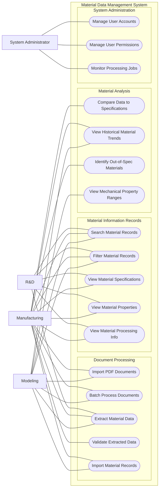

## Design -- Use Case Diagram
Epic: [#42](https://github.com/CPSC490-Team-Proj/CPSC490-G07-MightyMorphin/issues/42) · Stories: [#36](https://github.com/CPSC490-Team-Proj/CPSC490-G07-MightyMorphin/issues/36) 
Owner: Liam Wilson · Sprint: 2 · Status: draft 

