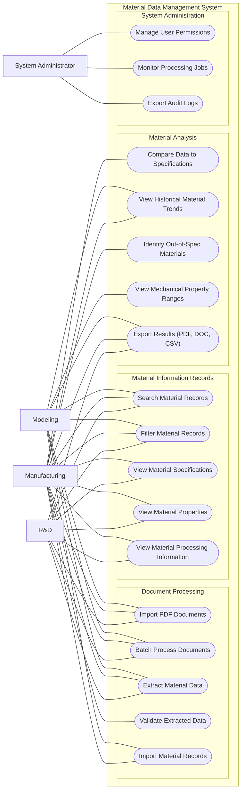

## Design -- Use Case Diagram
Epic: [#42](https://github.com/CPSC490-Team-Proj/CPSC490-G07-MightyMorphin/issues/42) · Stories: [#36](https://github.com/CPSC490-Team-Proj/CPSC490-G07-MightyMorphin/issues/36) 
Owner: Liam Wilson · Sprint: 2 · Status: draft 

## What the diagram shows

Four groups of Edwards employees use the system. Any employee in R&D,
Manufacturing or Modeling can import and batch-process PDF documents (to be
confirmed with the sponsor); Manufacturing also validates extracted data and
compares it to specifications. All three groups search, view and export
results (PDF, DOC, CSV; export is planned as one of the last features). The
System Administrator manages permissions, monitors processing jobs, and is the
only role that can export the audit log, which records every user action and
is not shown elsewhere in the web app. Everyone signs in with Edwards'
Microsoft SSO.

## What is NOT designed yet

- **The role list** will be reviewed by the team later (#78); which role may
  validate and approve data is not final.
- **Specification comparisons** (Compare Data to Specifications, Identify
  Out-of-Spec Materials) depend on Edwards supplying specification limits.
