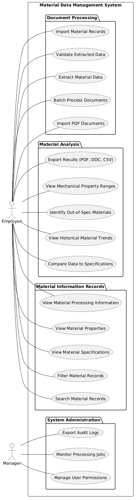
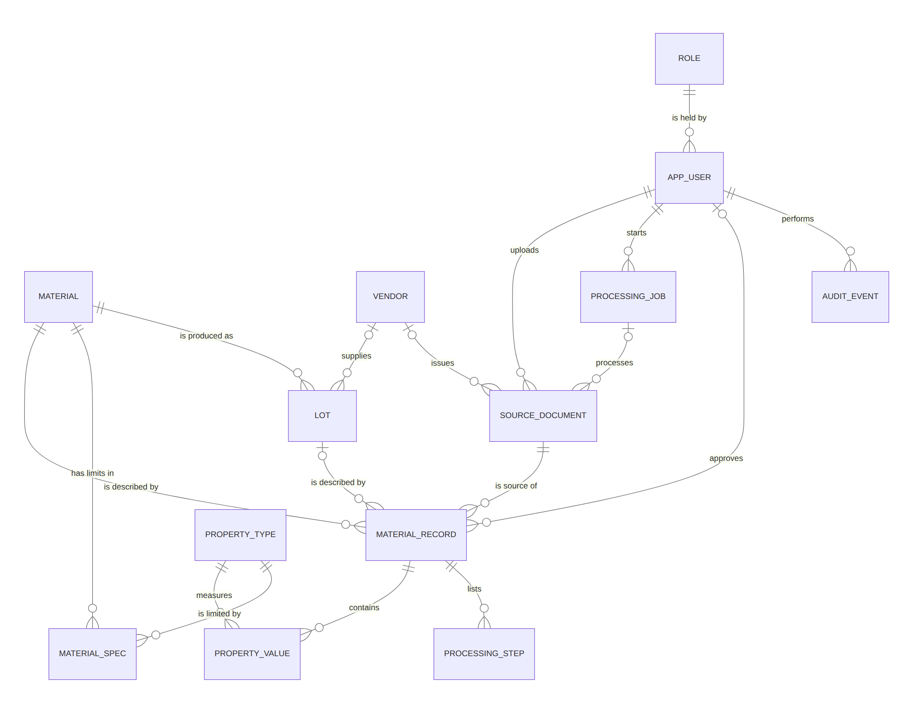
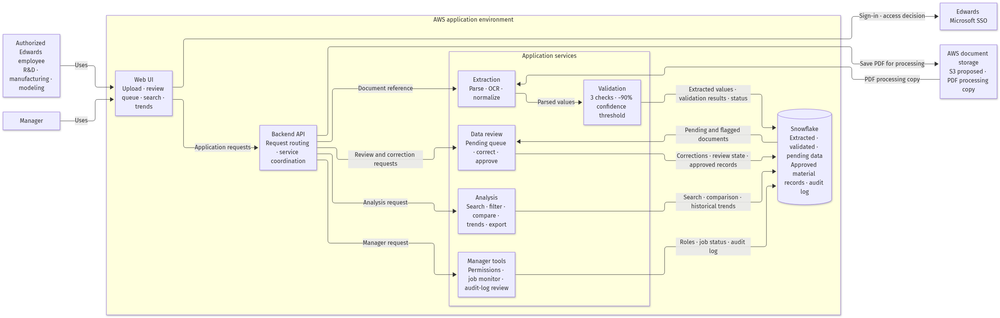
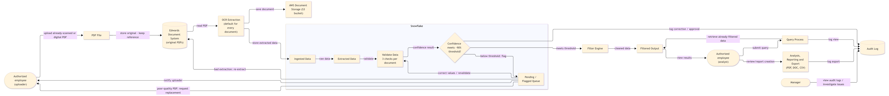
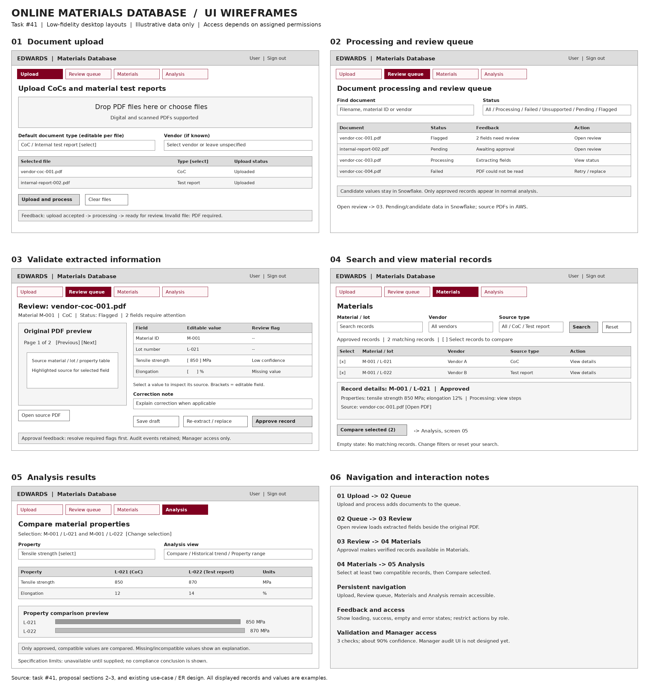
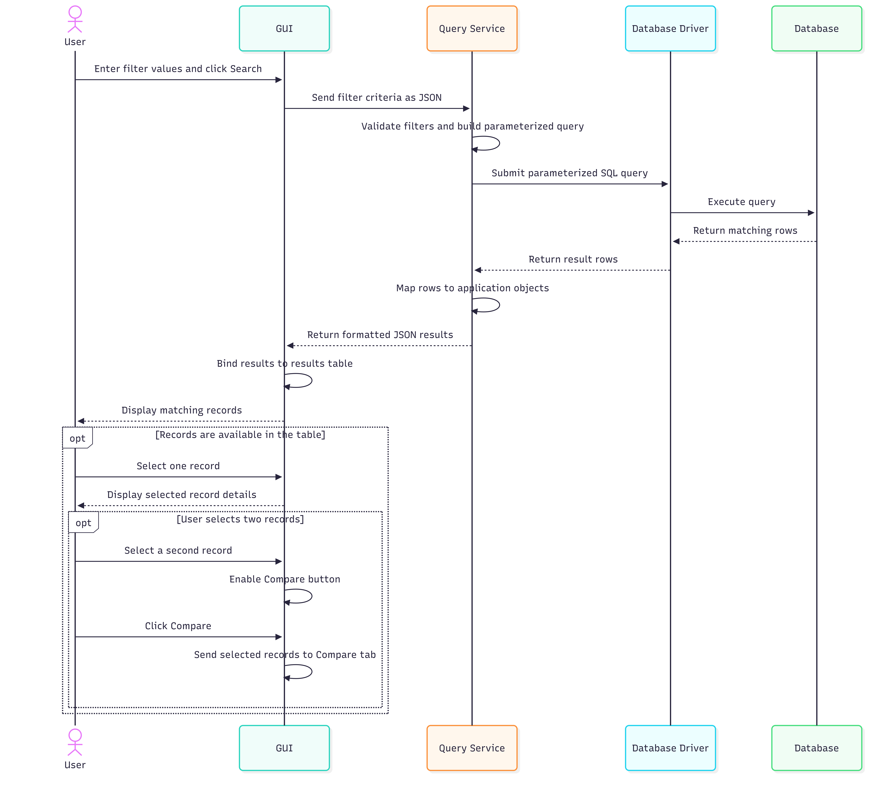

# Project Proposal — Online Material Database

**Department of Computer Science**
**CPSC 490 Undergraduate Seminar in Computer Science — Proposal for Capstone Project**

**Group 07 — Mighty Morphins** · Sponsor: EL-1
Authors: Nguyen Nguyen (GwenNguyen2604), Christopher Pham (cpham2005),
Bhavesh Malhi (Bhavesh1024), Fidelis Okorie (Kameo101), Liam Wilson
(liamw5265) Date: 〈2026-09-18〉

## 0. Abstract
&emsp;At Edwards Lifesciences, material information is contained in documents such as Certificates of Conformance (CoCs) received from external vendors and material test reports generated internally. Although these documents contain information about materials and their mechanical properties, the data contained within them is not currently maintained in a centralized, structured database. When users need to analyze material data across different samples or requests, they must locate the relevant reports and manually extract the necessary information. This process makes retrieving and comparing historical material information time consuming and prone to user mistakes, particularly when information from many documents is required.  
&emsp;The Online Materials Database project proposes a web application that converts information contained in these documents into structured and searchable material records. The proposed system will accept material documentation in PDF format, and extract relevant information such as material identification and mechanical properties. Extracted information will be verified where possible and hosted on AWS, but the database is Snowflake (provisional). The web application will provide authorized users with a centralized interface for accessing this information and searching or filtering records.  
&emsp;Developing such a system presents challenges beyond simply storing and displaying documents. Test documents and CoCs generated across a long period of time spanning years, with CoCs being from multiple vendors, can have inconsistent document format. This requires the system to accommodate different methods of obtaining and interpreting their contents. The accuracy of extracted information is particularly important because incorrectly interpreted material properties could affect the reliability of the resulting database. Automating this process while supporting heterogeneous documents therefore requires consideration of document processing, information extraction and verification, database design, and usability. A successful system would reduce repeated manual extraction of historical material data and make information more readily available for retrieval and analysis.
  
&emsp;The primary goals of the project are to develop a data extraction workflow for supported CoCs and test reports, establish centralized relational storage for the resulting material information, provide mechanisms for verifying extracted information, and develop an internal web application through which users can access the database. The expected outcome is a functional system that transforms supported material documents into structured records and allows authorized users to search, filter, and view historical material information. The system is intended to provide a foundation that can be expanded as additional document formats, material attributes, and analysis requirements are identified.  
&emsp;This proposal describes the problems motivating the Online Materials Database, the project's goals and objectives, and the proposed technical approach for addressing them.  
[#7](https://github.com/orgs/CPSC490-Team-Proj/projects/1/views/1?pane=issue&itemId=261452481&issue=CPSC490-Team-Proj%7CCPSC490-G07-MightyMorphin%7C7)

## 1. Introduction
&emsp;Engineering and manufacturing decisions rely heavily on accurate information for verifying material quality compliance, and performance. Important information such as vendor information, material properties and specifications is primarily recorded in the form of test reports and Certificates of Conformance (CoC). Although these documents are archived, the data itself is not stored in a structured format therefore you need to search for individual documents rather than querying a database.  
&emsp;The current method of storing documents creates several problems, Engineers need to manually locate individual documents and manually search through them to find specific data points. Comparing information across vendors or material types requires manual reviewing of multiple documents. This process becomes significantly inefficient as the number of records increases.  
&emsp;The goal of this project is to design and develop a centralized system for managing materials information contained in these CoC and test reports. The system focuses on extracting data from existing and future documents and stores them in a structured format. This data can be easily queried and analyzed to support better informed engineering decisions. The main problem that this project solves is the significant amount of manual data entry and searching required by the current process.  
&emsp;This project differs from a traditional document-management system like Dropbox or a cloud file server, because the primary focus is not simply storing documents. Instead, relevant data is extracted from the documents and stored in a structured database. The system also maintains references between the structured data and the original documents, allowing engineers to access the original PDF file whenever for further review..

### 1.1 Related Work
&emsp;Several existing technologies address parts of the problem involved with extracting and managing information from material documents. Google Cloud Document AI and Microsoft Azure Document Intelligence provide tools for extracting information from documents, while Ansys Granta ML focuses specifically on storing and managing materials data. Altho these systems function similarly to the proposed software, our approach to the problem is a more specific solution while the other softwares are more general.  
&emsp;<b>Google Cloud Document AI</b> provides document-processing tools that can extract text, key-value pairs, tables, and other structured information from PDF files and images[1]. Its Form Parser is designed to recognize information from structured documents requiring a custom model to be trained[4]. Google also provided custom extractors that allow users to define a schema containing the information they want to extract. The make Cloud Document AI useful when documents contain similar information but use different layouts. However, Cloud Document AI only provides a solution for the data extraction problem, the extracted data still needs to be stored somewhere. An additional application would still be needed to store this data after it is extracted.  
&emsp;<b>Microsoft Azure Document Intelligence</b> provides similar document-processing capabilities. It combines Optical Character Recognition (OCR) and document-analysis models to extract text, tables, key-values pairs, and document structure[2]. Microsoft also supports custom document extractions, making this service useful when extracting data from documents that have different layouts. Similar to Google Cloud Document AI these softwares are general purpose document processing softwares, the data extracted still needs to be stored somewhere.  
&emsp;<b>Ansys Granta MI</b> provides a solution to the storing of the data problem rather than data extraction. Granta MI is designed to create, store, manage, search, compare, and analyze material information[3]. It can combine an organization's material information with the built-in materials information and integrate the information with softwares like CAD or DAE. Granta MI is a solution to the materials database and analysis tool but it lacks the function of extracting information. A major feature of the proposed software is that it can extract data from different formatted documents but Granta MI can't do that.  
&emsp;<b>Shape Memory Materials Database</b> provides a reliable and accessible location for storing and displaying data on materials. The information pertains to the shape memory of the metals in the form of a chart. By utilizing a charting illustration researchers can compare the material's extremes to find the prime material for specific situations. Using the element table there are several selections to choose from and provides a simple choice board that researchers know and use. There is also a search filter to differentiate the data that is used to create the so the users know the data is reliable.  

| Existing approach | What it does | Pros | Cons | Why ours differs |
|---|---|---|---|---|
| Google Cloud Document AI / paper [1] | Extracts text, key-value pairs, tables, and structured fields from PDFs and images | Handles scanned and digital documants supports custom extraction schemas and differering document layouts | Primarly solves document extraction, a separate materials database, validations system, and user interface are key requirments | The proposed project integrates document extraction with data validation, storage, searching, and analysis |
| Microsoft Azure Document Intelligence / paper [2] | Uses OCR and document-analysis models to extract text, tables, structures and kay-value pairs. | Supports structured, semi-semi structred, and unstructured docuemnts.  Provides pretrained and customizable extraction capabilities | Primarly solves document extraction, a separate materials database, validations system, and user interface are key requirments| Our system is designed around specific feilds and workflows found in material CoCs and test repots. |
| Ansys Grnta MI / paper [3] | Centralized materials spec database, provides tools for searching, comparing, and analysis.  Allows for intrgration with custome materials inforamtion | Designed specifically for materials information.  Supports analysis and intrgration with Other softwares such as CAD and CAE | Focuses primaly on materials data management rahter than data extration. | The proposed project connects data extration with data storage for data analysis |
| Shape Memory Materials Database / product [4] | This product outputs data and structures the chart to reprsent the data on shape memory alloys | The chart proivided can compare two major attributes (temperature and structure) to find best materials for two extremes | The program is not open to providing your own data; and its all public information | The product we want to create allows for implementation of Edward's own unique documenation and data collection; which is privately accessible to Edwards affiliates |

[#6](https://github.com/orgs/CPSC490-Team-Proj/projects/1/views/1?pane=issue&itemId=261446190&issue=CPSC490-Team-Proj%7CCPSC490-G07-MightyMorphin%7C6)

### 1.2 Problem Statements
- <b>P.1 Unstructured Material Data:</b> Data from CoCs and test documents are primarily stored as either scanned documents or PDFs, making information difficult to query, analyze, and reuse.
- <b>P.2 Manual Data Extraction:</b> Extracting data from documents manually requires significant effort because there is no automated process for consistently extracting data from CoCs and testing documents.
- <b>P.3 Inconsistent Document Formats:</b> CoCs and test data documents come from many different sources, the data is not all in the same structured format.  This makes repeated extractions of data difficult.
- <b>P.4 Lack of Centralized Data Access:</b> There is no centralized materials repository that allows users to efficiently query historical records.  This causes overhead if users need to look to multiple sources for this data.
- <b>P.5 Limited Material Data Analysis:</b> Data is stored in scanned documents and PDFs rather than in a structured format.  Progress is negatively affected as users cannot efficiently query, analyze, and visualize historical data for engineering decisions.

| Problem | Addressed by |
|---|---|
| P1 Unstructured Material Data | Scanning and scraping the data from the PDFs and storing that data into a cloud database and implementing that data into a GUI that illustrates patterns in the material as well as allows users to filter search query |
| P2 Manual Data Extraction | Automated scanning programming that allows users to drag and drop file to extract metadata into database |
| P3 Inconsistent Document Formats | Take into account that there are several formats of data and forms we would first need to identify form types and keywords to extract necessary data |
| P4 Lack of Centralized Data Access | During GUI creation we will implement search filters for materials, dates, providers, and more upon stakeholder request |
| P5 Limited Material Data Analysis | Creation of this program will allow reliably and efficient work flow with centralized and organized data. Users will be able to look up material data, compare them in specific situations, and filter searches for relevant material |

[#5](https://github.com/orgs/CPSC490-Team-Proj/projects/1/views/1?pane=issue&itemId=261443686&issue=CPSC490-Team-Proj%7CCPSC490-G07-MightyMorphin%7C5)

## 2. Goals and Objectives
The Online Materials Database project aims to reduce the manual effort required to retrieve and analyze material information from Certificates of Conformance (CoCs) and material test reports. The project will establish a Snowflake environment, process and validate submitted documents, preserve the source documents and workflow history, and provide authorized users with tools to search, review, compare, and visualize approved data. The following goals and objectives define the primary capabilities to be developed and provide measurable criteria for evaluating the completed system.   

- **Goal 0: Design and Specification Documents** [epic:#42](https://github.com/CPSC490-Team-Proj/CPSC490-G07-MightyMorphin/issues/42)
  
  - Objective 0.1: Design and Architecture [[story:#48]](https://github.com/CPSC490-Team-Proj/CPSC490-G07-MightyMorphin/issues/48)
  - Objective 0.2: Epic Specification Documents [[story:#49]](https://github.com/CPSC490-Team-Proj/CPSC490-G07-MightyMorphin/issues/49)

- **Goal 1: Snowflake Setup and Document Ingestion/Validation** [epic:#11](https://github.com/CPSC490-Team-Proj/CPSC490-G07-MightyMorphin/issues/11)
  The first goal establishes Snowflake for approved material-data storage and provides the intake, extraction, normalization, failure-handling, validation, and review workflow for supported CoCs and material test reports.
  
  - Objective 1.1: Configure Snowflake for material-data ingestion [story:#12](https://github.com/CPSC490-Team-Proj/CPSC490-G07-MightyMorphin/issues/12)
  - Objective 1.2: Accept and initiate processing for supported material documents [story:#13](https://github.com/CPSC490-Team-Proj/CPSC490-G07-MightyMorphin/issues/13)
  - Objective 1.3: Extract and normalize candidate material data [story:#14](https://github.com/CPSC490-Team-Proj/CPSC490-G07-MightyMorphin/issues/14)
  - Objective 1.4: Handle unsupported documents and processing failures [story:#15](https://github.com/CPSC490-Team-Proj/CPSC490-G07-MightyMorphin/issues/15)
  - Objective 1.5: Validate and approve candidate material data [story:#16](https://github.com/CPSC490-Team-Proj/CPSC490-G07-MightyMorphin/issues/16)

- **Goal 2: Material and Source-Document Storage** [epic:#17](https://github.com/CPSC490-Team-Proj/CPSC490-G07-MightyMorphin/issues/17)
  The second goal preserves original PDFs in AWS S3 and stores source metadata, candidate values, pending workflow state, validation results and review history in Snowflake. Only approved material data is published to the approved-record dataset for search and analysis; candidate persistence is distinct from approval. Source references and ingestion outcomes maintain end-to-end traceability.

  - Objective 2.1: Store original source documents and document metadata [story:#18](https://github.com/CPSC490-Team-Proj/CPSC490-G07-MightyMorphin/issues/18)
  - Objective 2.2: Store candidate records, workflow status, and review history [story:#19](https://github.com/CPSC490-Team-Proj/CPSC490-G07-MightyMorphin/issues/19)
  - Objective 2.3: Store approved material data in Snowflake [story:#20](https://github.com/CPSC490-Team-Proj/CPSC490-G07-MightyMorphin/issues/20)
  - Objective 2.4: Maintain storage reliability and source-to-record traceability [story:#21](https://github.com/CPSC490-Team-Proj/CPSC490-G07-MightyMorphin/issues/21)

- **Goal 3: Material Search, Viewing, and Analysis** [epic:#22](https://github.com/CPSC490-Team-Proj/CPSC490-G07-MightyMorphin/issues/22)
  The third goal provides authorized users with a secure internal application to search, view, compare, and visualize approved material data while preserving the source and review context for each record.

  - Objective 3.1: Authenticate and authorize application users [story:#23](https://github.com/CPSC490-Team-Proj/CPSC490-G07-MightyMorphin/issues/23)
  - Objective 3.2: Search and filter approved material records [story:#24](https://github.com/CPSC490-Team-Proj/CPSC490-G07-MightyMorphin/issues/24)
  - Objective 3.3: View approved material-record details and source context [story:#25](https://github.com/CPSC490-Team-Proj/CPSC490-G07-MightyMorphin/issues/25)
  - Objective 3.4: Compare approved material records [story:#26](https://github.com/CPSC490-Team-Proj/CPSC490-G07-MightyMorphin/issues/26)
  - Objective 3.5: Visualize compatible material-property data [story:#27](https://github.com/CPSC490-Team-Proj/CPSC490-G07-MightyMorphin/issues/27)

## 3. Proposed Approaches

The proposed system replaces manual lookup of Certificates of Conformance (CoC) and
test reports. This uses a pipeline that is made of four stages: document ingestion,
data extraction, verification, and structured storage with web access. Each
stage addresses one or more of the problems that were identified in §1.2.

**Digital and scanned documents.** All of the incoming PDFs fall into two categories which are:

- Documents generated digitally, which contain an embedded text layer

- Scanned documents, which are images of paper forms that were already scanned before they reach the system.

The system does not scan any paper itself because everything will already be scanned; users upload PDFs that already exist.
Every document, digital or scanned, is passed through optical character recognition (OCR)
before entering the same extraction step. Scanned documents will first be cleaned
up (straightened and contrast adjusted as well as other methods) before OCR to reduce errors. This
single path still supports older scanned records that may need to be added. When a
document is extracted, a copy of it is saved to the sponsor's AWS storage so every record
can point back to its source as well.

**Handling different document formats.** Because CoCs and test reports come
from many vendors, the same information appears in different positions and
under different labels. To solve this the system will first identify the type and source of
each document, then apply a field mapping for that format, falling back on
label based matching for layouts it has not seen before. All
results are normalized into a single common record with consistent field
names and units, regardless of the source format. New vendor formats can then
be supported by adding a mapping rather than changing the extraction logic. This approach may change once the team has actual test documents to reference, since some formats may already be standardized, but those documents are not yet in the team's possession.

**Verifying extracted data.** Automated extraction will not be correct every
time. To make sure no error chance is overlooked, the program will ensure no extracted value is treated as trustworthy by default. Each result
will be checked for missing required fields, incorrect data types or units,
values outside plausible ranges, and low recognition confidence. The same OCR tool
will run each document three times, and then the confidence level of each result must reach roughly 90%.
Records that fail any check or do not reach 90% confidence are flagged for review. The extracted values stay in Snowflake
as pending until they are reviewed and pass validation. A user can then compare the
extracted values against the original document, correct them, and approve the
record. Only approved records are stored as verified material data, and
each correction and approval is logged, which should minimize any and all errors the program could possibly produce.

**Storage and access.** Verified data will be stored in Snowflake, a cloud data platform that the company is already utilizing, using a relational model that represents materials, mechanical properties, documents, vendors, and lots as
related records. A relational design suits this data because it is highly
structured and repetitive, and because users need to filter and compare
values across many records. Every record keeps a reference to the copy of the original
PDF saved in the sponsor's AWS storage so that users can always trace a value back to its source and verify if highly sensitive data is included. Authorized
Edwards users will access the system through an internal web application
that supports document upload, the review queue, search and filtering by
material and vendor, and side by side comparison of material properties. A
web application was chosen because it requires no installation, centralizes
access control, and gives every user the same source of truth.

**Alternatives considered.** Four alternatives were considered. First,
general purpose cloud document extraction services [1][2] extract text and
fields well but provide no materials database, verification workflow, or
user interface, so most of the system would still need to be built. Second,
a dedicated materials data platform [3] offers strong storage and analysis
but no extraction, which leaves manual data entry (P.2) unsolved. Third,
keeping the current manual process costs nothing but addresses none of the
stated problems. Fourth, the sponsor's existing cloud data platform (Snowflake), which
includes AI-based document processing, could handle document ingestion
directly. This option is attractive because the sponsor already uses and
supports the platform, the data would stay within the sponsor's environment,
and the team would only need to build the code that verifies the ingested
results. However, the team has not yet confirmed how well the platform
handles scanned documents and varied vendor formats, and the option depends
on the sponsor's platform access and setup. After reviewing it, the team
chose Snowflake as the project's database. The team therefore proposes an integrated pipeline
that connects extraction, verification, storage, and analysis and is
tailored to the fields found in CoCs and test reports. The extraction tool has not
been decided on yet and will require testing, with Snowflake's system being the most likely. Other options include Amazon Textract or Tesseract. The ingestion step
will either be built by the team or handled by the sponsor's platform,
depending on that choice; the verification, storage, and
web application components are required in either case.

The implementation stack, hosting environment, and design diagrams are
detailed in §4.

## 4. Required Environment, Resources, and Planned Activities
The development of the Edwards Lifescience Materials Database requires various software technologies, a development environment, and technical skills. The table below outlines the planned resources and their purpose within the project.

|Category|Technology/Resource|Purpose|
|-----|-----|-----|
|Programming Language|Python| - Backend development  - Document extraction  - Data processing|
|Database Management System|Snowflake|Store and analyze approved material data and the audit log|
|Hosting|AWS|Run the web app, backend API and services|
|Authentication|Edwards Microsoft SSO|Sign users in with their Edwards account|
|File Storage (PDFs)|AWS|Original PDFs are saved to the sponsor's AWS storage and records point to that copy|
|Backend Framework|FastAPI (Python)|- Handles application logic  - Communication between components|
|UI/UX Design|Figma|Design wireframes and mockups of user interface [#41](https://github.com/CPSC490-Team-Proj/CPSC490-G07-MightyMorphin/issues/41)|
|Frontend Framework|React/Vue|User interface (upload documents, view extracted data)|
|Document Processing|OCR on every document; tool not chosen (Snowflake document AI, Textract or Tesseract)|Extract data from uploaded documents|
|Development Environment|Visual Studio Code|Write, debug, test code|
|Version Control|Git and GitHub|Track sprint progress, tasks, and assignments|

**Alternatives confirmed**
Python was chosen as the primary programming language because it is widely known by the entire group and is easily reveiwable. Database Management System is now officially run on Snowflake. This decision was made with reasoning that Edwards already uses and support Snowflake. Alternatives (ProstgreSQL) was rejected due to the substantial benefits that come from using Snowflake. AWS was chosen for hosting because it is a software that is recognized by Edwards. Authentication utilizes Edwards Microsoft SSO because the software can be used by any authrozied employee. Additionally this can help with logging viewership and changes made by each account. File Storage (PDFs) is now officially utilizes AWS to store the original documents. There were no alternatives, it has just been confirmed by sponsor. The Development environment utilized is Visual Studio Code. Version Control is maintained by Git and Github.
**Undecided Technology/Resource(s)**
Technology for extraction tool will be decided after snowflake trial. Alternatives for extraction tool include Snowflake, Textract, and Tesseract. Frontend area tool has not been decided as of November 16, 2026. Options for frontend include React and Vue.

*Figure 1. Use Case Diagram.*

*Figure 2. ER Diagram.*

Key: Two bars = exactly one; bar and circle = zero or one; circle and fork = zero or many.
For the Full Column and keys view: `docs/design/er-diagram.md`.

Figure 2 shows the data model behind the materials database. A `MATERIAL` is identified by the material ID printed on the document, and it can be produced as many `LOT`s. A `VENDOR` supplies lots and issues documents, but both links are optional because not every CoC or test report names its vendor or lot. Each uploaded PDF becomes one `SOURCE_DOCUMENT`, which records whether it is a CoC or a test report, who uploaded it, and how far processing has gone. Extraction turns a document into one or more `MATERIAL_RECORD`s, and each record holds one `PROPERTY_VALUE` per mechanical property it reports. Every value points to a shared `PROPERTY_TYPE`, which gives the property one name and one standard unit, so values from different vendors, and the limits in `MATERIAL_SPEC`, can be compared directly. Each value also keeps the unit as it was printed and the extraction confidence, which the review step uses. [[task:#38]](https://github.com/CPSC490-Team-Proj/CPSC490-G07-MightyMorphin/issues/38) · [[task:#107]](https://github.com/CPSC490-Team-Proj/CPSC490-G07-MightyMorphin/issues/107) · [[task:#172]](https://github.com/CPSC490-Team-Proj/CPSC490-G07-MightyMorphin/issues/172)

The remaining tables describe who uses the system and how work moves through it. Each `APP_USER` is an Edwards employee who signs in through Edwards' Microsoft single sign-on, and each user holds exactly one `ROLE`, matching the separate groups of actors in the use case diagram (Figure 1). A user can upload a single document or start a `PROCESSING_JOB` that handles a batch of documents together; a document uploaded on its own simply has no job. Each `SOURCE_DOCUMENT` carries a processing status (uploaded, processing, failed, unsupported or done), so the Monitor Processing Jobs use case can show where every file is without a separate tracking table. `PROCESSING_STEP` stores the processing information printed on a document, such as heat treatment, as ordered text, because the team has not yet seen enough real documents to give it a more detailed structure. [[task:#36]](https://github.com/CPSC490-Team-Proj/CPSC490-G07-MightyMorphin/issues/36) · [[task:#38]](https://github.com/CPSC490-Team-Proj/CPSC490-G07-MightyMorphin/issues/38)

A short example shows how one document moves through these tables. The values here are illustrative only and are not taken from any sponsor document. Suppose a user uploads a CoC for one lot of a material. The upload creates a `SOURCE_DOCUMENT` row marked as a CoC, and the PDF is saved to S3 with its object key and checksum. If the vendor and material are new to the system, extraction adds a `VENDOR` and a `MATERIAL` row, plus a `LOT` row for the lot number printed on the certificate. It then creates one `MATERIAL_RECORD` that ties the document, material and lot together, and one `PROPERTY_VALUE` for each mechanical property reported on the certificate. If the certificate prints a value in a different unit from the standard unit for that `PROPERTY_TYPE`, the value is converted to the standard unit, and the unit as printed is kept in `unit_as_printed` so a reviewer can check the conversion against the PDF. When a second certificate for the same material arrives later from another vendor, it reuses the same `MATERIAL` and `PROPERTY_TYPE` rows, which is what lets the two vendors' results be compared side by side. [[feature:#163]](https://github.com/CPSC490-Team-Proj/CPSC490-G07-MightyMorphin/issues/163) · [[task:#107]](https://github.com/CPSC490-Team-Proj/CPSC490-G07-MightyMorphin/issues/107) · [[task:#109]](https://github.com/CPSC490-Team-Proj/CPSC490-G07-MightyMorphin/issues/109)

The diagram is built so that every value can be traced back to the file it came from. A property value belongs to exactly one material record, and a material record has exactly one source document, which the design marks as required. The source document then stores the AWS S3 object key and a checksum of the PDF, so a reviewer can open the exact file and confirm it has not been replaced. Alongside that chain, every upload, view, correction, approval, edit, delete and export is written to `AUDIT_EVENT` with the user who did it, which gives the Manager a full history of how each record reached its current state. [[task:#109]](https://github.com/CPSC490-Team-Proj/CPSC490-G07-MightyMorphin/issues/109) · [[feature:#163]](https://github.com/CPSC490-Team-Proj/CPSC490-G07-MightyMorphin/issues/163)

Snowflake is the confirmed platform for all of the structured data in Figure 2, including the audit log. Extracted values are written to Snowflake as soon as extraction finishes, with a `review_status` of pending, or flagged when a check fails or the confidence is below about 90%. Only records a user has approved are shown in search and analysis, so those are the verified material data. Snowflake does not store the PDF files themselves. When processing starts, the PDF is saved to the proposed AWS S3 processing storage, and Snowflake keeps only its object key and checksum. [[task:#78]](https://github.com/CPSC490-Team-Proj/CPSC490-G07-MightyMorphin/issues/78) · [[feature:#152]](https://github.com/CPSC490-Team-Proj/CPSC490-G07-MightyMorphin/issues/152) · [[feature:#163]](https://github.com/CPSC490-Team-Proj/CPSC490-G07-MightyMorphin/issues/163) · [[task:#108]](https://github.com/CPSC490-Team-Proj/CPSC490-G07-MightyMorphin/issues/108)

The review process is part of the data model, not something kept outside it. Every new `MATERIAL_RECORD` starts as pending. During verification, the system runs the same OCR tool on each document three times and checks the results for missing required fields, wrong data types or units, values outside plausible ranges, and low confidence. A record that fails any check, or whose confidence stays below about 90%, is marked flagged, and the reason is stored in `flag_reason` on the affected `PROPERTY_VALUE`. A user with permission then compares the values with the PDF, corrects any mistakes, and approves the record; the record's status becomes approved, and the user and time are saved in `approved_by` and `approved_at`. A record can also be rejected. Every correction is written to `AUDIT_EVENT` with the field name and the old and new values, so the history of a value is never lost even after it is fixed. The uploader is notified when their document needs review, and it stays in the review queue until it is resolved. [[feature:#88]](https://github.com/CPSC490-Team-Proj/CPSC490-G07-MightyMorphin/issues/88) · [[feature:#160]](https://github.com/CPSC490-Team-Proj/CPSC490-G07-MightyMorphin/issues/160) · [[feature:#161]](https://github.com/CPSC490-Team-Proj/CPSC490-G07-MightyMorphin/issues/161) · [[feature:#162]](https://github.com/CPSC490-Team-Proj/CPSC490-G07-MightyMorphin/issues/162)

Several features in Goal 3 do not need tables of their own because they are queries over the tables in Figure 2. Search and filtering read `MATERIAL`, `VENDOR`, `LOT` and the document type, limited to approved records. Comparing data to specifications joins each `PROPERTY_VALUE` to the `MATERIAL_SPEC` row with the same material and property type, and a value is out of spec when it falls below `min_value` or above `max_value`. Historical trends order a property's values by the date printed on their source documents, and property ranges are the minimum and maximum of the values for one property type. Exporting results reuses these same queries and adds an `AUDIT_EVENT` with the export action. Only the specification limits need data the team does not have yet: `MATERIAL_SPEC` assumes Edwards can supply an allowed range for each material and property, and that has not been confirmed with the sponsor. [[feature:#90]](https://github.com/CPSC490-Team-Proj/CPSC490-G07-MightyMorphin/issues/90) · [[task:#113]](https://github.com/CPSC490-Team-Proj/CPSC490-G07-MightyMorphin/issues/113) · [[feature:#95]](https://github.com/CPSC490-Team-Proj/CPSC490-G07-MightyMorphin/issues/95) · [[task:#36]](https://github.com/CPSC490-Team-Proj/CPSC490-G07-MightyMorphin/issues/36)

Several design choices in Figure 2 were made over specific alternatives. Property values are stored one row per value in `PROPERTY_VALUE` instead of one column per property on the record, because CoCs and test reports from different vendors list different properties, and a new property should not require changing the schema. Property names live in the shared `PROPERTY_TYPE` table instead of as free text on each value, because a value and a specification limit can only be compared if they name the same property in the same unit. The link to the source is stored once on each `MATERIAL_RECORD` instead of on every property value, which meets the traceability requirement without repeating the same reference many times. Out-of-spec status is calculated when it is needed instead of being stored as a flag, because a stored flag would become wrong whenever a specification limit changed. Unapproved records are stored in Snowflake with a status instead of being kept out of the database until approval; the earlier design left the review screen with nowhere to read pending values from. Original PDFs are copied to S3 instead of being stored inside Snowflake or referenced only in Edwards' own document system, because the team decided to save each document to S3 at the OCR step and to keep Snowflake for structured data only. Finally, every user action is logged instead of only corrections and approvals, so Edwards can trace each upload, view, change and export. [[task:#38]](https://github.com/CPSC490-Team-Proj/CPSC490-G07-MightyMorphin/issues/38) · [[task:#78]](https://github.com/CPSC490-Team-Proj/CPSC490-G07-MightyMorphin/issues/78) · [[task:#172]](https://github.com/CPSC490-Team-Proj/CPSC490-G07-MightyMorphin/issues/172)

Some parts of the model are not decided yet. The column types in the diagram are generic SQL types, and the final Snowflake schema will be set when the tables are built. Standard Snowflake tables record primary and foreign keys but do not enforce them, so the application will have to check those links itself, and how it does that is still open. Which fields are optional or must be unique depends on real CoCs and test reports, which the team does not have yet. The retention policy, how long the S3 copy is kept, and the S3 lifecycle rules depend on the sponsor. [[feature:#152]](https://github.com/CPSC490-Team-Proj/CPSC490-G07-MightyMorphin/issues/152) · [[task:#107]](https://github.com/CPSC490-Team-Proj/CPSC490-G07-MightyMorphin/issues/107) · [[task:#110]](https://github.com/CPSC490-Team-Proj/CPSC490-G07-MightyMorphin/issues/110) · [[task:#172]](https://github.com/CPSC490-Team-Proj/CPSC490-G07-MightyMorphin/issues/172)

*Figure 3. System Architecture Diagram.*

Figure 3 shows how an authorized Edwards employee uses the web UI and how requests pass through the backend API to application services. Edwards Microsoft SSO supplies the sign-in and access decision. The API coordinates document intake, extraction, review, and data access; users do not connect directly to Snowflake. A Manager uses the same application to manage permissions, monitor job status, and inspect audit events when investigating a failure.

Documents enter as digital or already-scanned PDFs; physical scanning is outside the application. The application stages a processing copy in AWS storage, with S3 proposed, and passes it to the extraction service. The extraction product has not been selected. Extracted values and workflow states, including validated, pending, and flagged results, are tracked in Snowflake. Validation checks each document three times and uses an approximately 90% confidence threshold; results below that threshold are flagged for review. An authorized reviewer can inspect and correct pending or flagged values. Only after approval do the values become approved material records in Snowflake. The original PDF is not stored in Snowflake; the record keeps a source reference to the AWS processing copy.

Search, filtering, comparison, and historical analysis use approved material records from Snowflake through the application services. The team selected Snowflake for structured material-data ingestion, storage, and analysis over PostgreSQL on Amazon RDS, and chose AWS/S3 processing storage rather than treating Snowflake as a PDF file store. The exact extraction tool, S3 lifecycle and retention policy, confidence-scoring calibration, final Snowflake schema details, and detailed Manager permissions remain undecided; the diagram describes the agreed direction, not a fully deployed integration. [[task:#173]](https://github.com/CPSC490-Team-Proj/CPSC490-G07-MightyMorphin/issues/173) · [[task:#118]](https://github.com/CPSC490-Team-Proj/CPSC490-G07-MightyMorphin/issues/118) · [[feature:#78]](https://github.com/CPSC490-Team-Proj/CPSC490-G07-MightyMorphin/issues/78)

*Figure 4. Data Flow Diagram.*

Key: Diamond = decision; oval = user entity; cylindar = database; rectangles = process

*Figure 5. UI Wireframes. Screen navigation and interaction notes are included in the overview.*

The five user screens separate PDF upload, processing/review queue, validation,
material search, and analysis. Existing PDFs are accepted without physical
scanning; at OCR processing they are saved to AWS, while candidate values,
pending items, validation results and approved records live in Snowflake with
distinct review statuses. Validation makes three checks with an approximately
90% confidence target; aggregation and exact thresholds remain unspecified.
Review places editable values beside the source PDF, preserving human approval
instead of treating every extracted value as verified. A separate queue was
chosen over putting processing and correction into a single upload screen.
Regular user history panels were removed because audit-log investigation and
export belong to the Manager. Search retains source-document links and passes
selected approved records to comparison. Exact permissions, the Manager UI,
confidence aggregation and later export behavior are not designed here.
[[task:#122]](https://github.com/CPSC490-Team-Proj/CPSC490-G07-MightyMorphin/issues/122)
[[task:#41]](https://github.com/CPSC490-Team-Proj/CPSC490-G07-MightyMorphin/issues/41)

*Figure 6.4. Search, View, and Record Selection Sequence Diagram. The figure shows how a user searches for records by entering filter criteria in the GUI. The request is sent through the Query Service and Database Driver to retrieve matching database records, which are returned and displayed in a results table. Users can select a record to view its details or select two records, enabling the Compare button and passing the selected records to the Compare tab.*

### Specification and design documents
| Document | Kind | Covers | Issues |
|----------|------|--------|--------|
|[Use Case Diagram](../docs/design/use-case.md)|Design|Maps interactions between external users or systems with the software application's core functions within the system| [#36](https://github.com/CPSC490-Team-Proj/CPSC490-G07-MightyMorphin/issues/36) |
|[ER Diagram](../docs/design/er-diagram.md)|Design|This defines the relational data model for the material data the system extracts and verifies. It stores each uploaded CoC or test report as a source document, the material, lot and vendor it describes, and every mechanical property value with its unit and extraction confidence. Each material record links to exactly one source document, and the document keeps the AWS S3 object key and checksum of its PDF, so any value can be traced back to the original file. Snowflake is the confirmed platform for all of this structured data, including records that are still pending or flagged for review; only approved records count as verified material data, and the PDFs stay in S3, not in Snowflake. Every user action, including each correction and approval, is logged. Specification limits support the out-of-spec and comparison use cases in the use case diagram. The final Snowflake schema, optional fields and constraints, and the retention and S3 lifecycle rules are not decided yet; the full diagram with every column is in docs/design/er-diagram.md.|[[task:#38]](https://github.com/CPSC490-Team-Proj/CPSC490-G07-MightyMorphin/issues/38) · [[task:#172]](https://github.com/CPSC490-Team-Proj/CPSC490-G07-MightyMorphin/issues/172)|
|[System Architecture](../docs/design/system-architecture-diagram.md)|Design|Maps out relationships between core components within the system; exported image: [PNG](../docs/design/system-architecture-diagram.png)|[#39](https://github.com/CPSC490-Team-Proj/CPSC490-G07-MightyMorphin/issues/39)|
|[Data Flow Diagram](../docs/design/data-flow.md)|Design|Maps how information moves, transforms, and stored within the system. Diagram demonstrates how desired media is scanned, stored, and how data is scraped, reviewed, then stored.|[#40](https://github.com/CPSC490-Team-Proj/CPSC490-G07-MightyMorphin/issues/40)|
|[UI Wireframes](../docs/design/ui-wireframe/ui-wireframe.md)|Design|Primary screen layouts and navigation for upload, review, stored records and analysis; [PNG](../docs/design/ui-wireframe.png) and [editable SVG](../docs/design/ui-wireframe/ui-wireframe.svg)|[#41](https://github.com/CPSC490-Team-Proj/CPSC490-G07-MightyMorphin/issues/41)|
|[Sequence Diagram - Search and View](../docs/design/sequence-search-view.md)|Design|This diagram shows how users search for records, view search results, and select two records to enable comparison.|[#89](https://github.com/CPSC490-Team-Proj/CPSC490-G07-MightyMorphin/issues/89)|
|[Processing and Review Queue Sequence Diagram](../docs/design/sequence-review-queue/sequence-review-queue.md)|Design|Page 2 queue, processing status, review handoff, and retry flows; [PNG](../docs/design/sequence-review-queue/sequence-review-queue.png) and [editable PlantUML](../docs/design/sequence-review-queue/sequence-review-queue.puml)|[#92](https://github.com/CPSC490-Team-Proj/CPSC490-G07-MightyMorphin/issues/92)|
|[Technology Stack and System Decisions](../docs/design/technology-stack-decision.md)|Design|Records which technology and system-behavior choices the team selected, left provisional or deferred, with the alternatives and reasons; every design document follows it|[[feature:#78]](https://github.com/CPSC490-Team-Proj/CPSC490-G07-MightyMorphin/issues/78)|
|[Specification — Goal 1: Snowflake Setup and Document Ingestion/Validation](../docs/specs/goal-1-snowflake-ingestion-validation.md)|Specification|Specification document for Goal 1: Automated Material Data Extraction and Verification|[#46](https://github.com/CPSC490-Team-Proj/CPSC490-G07-MightyMorphin/issues/46)|
|[Specification — Goal 2: Material and Source-Document Storage](../docs/specs/goal-2-storage-management.md)|Specification|Specification document for Goal 2: Centralized Material Data Storage and Management|[#58](https://github.com/CPSC490-Team-Proj/CPSC490-G07-MightyMorphin/issues/58)|
|[Specification — Goal 3: Material Search, Viewing, and Analysis](../docs/specs/goal-3-material-search-viewing-analysis.md)|Specification|Specification document for Goal 3: Material Data Access and Analysis|[#59](https://github.com/CPSC490-Team-Proj/CPSC490-G07-MightyMorphin/issues/59)|
|[Page 5 Analysis Sequence](../docs/design/sequence-analysis/analysis-sequence.md)|Design|Shows approved-record comparison, trend/range requests, and empty/error responses.|[[task:#94]](https://github.com/CPSC490-Team-Proj/CPSC490-G07-MightyMorphin/issues/94)|

### Planned activities — the work items

Proposal preparation is tracked under [[epic:#4]](https://github.com/CPSC490-Team-Proj/CPSC490-G07-MightyMorphin/issues/4),
including abstract work [[task:#28]](https://github.com/CPSC490-Team-Proj/CPSC490-G07-MightyMorphin/issues/28).
Sponsor intake and architecture forms are tracked under
[[epic:#45]](https://github.com/CPSC490-Team-Proj/CPSC490-G07-MightyMorphin/issues/45); confidential form contents are
not included in this repository. Specification documents are coordinated through
[[story:#49]](https://github.com/CPSC490-Team-Proj/CPSC490-G07-MightyMorphin/issues/49).

| Issue | Type | Activity | Parent | Owner | Sprint |
|---|---|---|---|---|---|
[@GwenNguyen2604](https://github.com/GwenNguyen2604) [@Bhavesh1024](https://github.com/Bhavesh1024)|Sprint 1|
|[[task:#37]](https://github.com/CPSC490-Team-Proj/CPSC490-G07-MightyMorphin/issues/37)|Task|Draft §2 Goals and Objectives|Standalone Documentation Task|[@GwenNguyen2604](https://github.com/GwenNguyen2604)|Sprint 1|
|[[task:#52]](https://github.com/CPSC490-Team-Proj/CPSC490-G07-MightyMorphin/issues/52)|Task|Complete §3 Proposed Approaches|Standalone Documentation Task|[@Kameo101](https://github.com/Kameo101)|Sprint 1|
|[[task:#53]](https://github.com/CPSC490-Team-Proj/CPSC490-G07-MightyMorphin/issues/53)|Task|Complete §4 Required Environment, Resources, and Planned Activities|Standalone Documentation Task|[@liamw5265](https://github.com/liamw5265)|Sprint 1|
|[[task:#29]](https://github.com/CPSC490-Team-Proj/CPSC490-G07-MightyMorphin/issues/29)|Task|Synchronize `develop` with `main`|Standalone Documentation Task|[@Kameo101](https://github.com/Kameo101)|Sprint 1|
|[[task:#54]](https://github.com/CPSC490-Team-Proj/CPSC490-G07-MightyMorphin/issues/54)|Task|Synchronize §2 Goals and Objectives with GitHub Issues|Standalone Documentation Task|[@cpham2005](https://github.com/cpham2005)|Sprint 1|
|[[task:#34]](https://github.com/CPSC490-Team-Proj/CPSC490-G07-MightyMorphin/issues/34)|Task|Add Hyperlinks and Credits to `proposal.md`|Standalone Documentation Task|[@Kameo101](https://github.com/Kameo101) [@cpham2005](https://github.com/cpham2005) [@Bhavesh1024](https://github.com/Bhavesh1024) [@liamw5265](https://github.com/liamw5265)|Sprint 1|
|[[task:#51]](https://github.com/CPSC490-Team-Proj/CPSC490-G07-MightyMorphin/issues/51)|Task|Fix Typed Hyperlink References in `proposal.md`|Standalone Documentation Task|[@Bhavesh1024](https://github.com/Bhavesh1024)|Sprint 1|
|[[task:#57]](https://github.com/CPSC490-Team-Proj/CPSC490-G07-MightyMorphin/issues/57)|Task|Update `README.md` with Project Information and Sprint Board|Standalone Documentation Task|[@Bhavesh1024](https://github.com/Bhavesh1024)|Sprint 1|
|[[task:#55]](https://github.com/CPSC490-Team-Proj/CPSC490-G07-MightyMorphin/issues/55)|Task|Complete Sprint 1 Review|Standalone Documentation Task|[@cpham2005](https://github.com/cpham2005)|Sprint 1|
|[[task:#36]](https://github.com/CPSC490-Team-Proj/CPSC490-G07-MightyMorphin/issues/36)|Task|Create Use-Case Diagram|[[story:48]](https://github.com/CPSC490-Team-Proj/CPSC490-G07-MightyMorphin/issues/48)|[@liamw5265](https://github.com/liamw5265)|Sprint 2|
|[[task:#38]](https://github.com/CPSC490-Team-Proj/CPSC490-G07-MightyMorphin/issues/38)|Task|Create ER Diagram|Standalone Documentation Task|[@Kameo101](https://github.com/Kameo101)|Sprint 2|
|[[task:#39]](https://github.com/CPSC490-Team-Proj/CPSC490-G07-MightyMorphin/issues/39)|Task|Create System Architecture Diagram|Standalone Documentation Task|[@Bhavesh1024](https://github.com/Bhavesh1024)|Sprint 2|
|[[task:#40]](https://github.com/CPSC490-Team-Proj/CPSC490-G07-MightyMorphin/issues/40)|Task|Create Data-Flow Diagram|Standalone Documentation Task|[@cpham2005](https://github.com/cpham2005)|Sprint 2|
|[[task:#41]](https://github.com/CPSC490-Team-Proj/CPSC490-G07-MightyMorphin/issues/41)|Task|Create UI Wireframe|[[story:48]](https://github.com/CPSC490-Team-Proj/CPSC490-G07-MightyMorphin/issues/48)|[@GwenNguyen2604](https://github.com/GwenNguyen2604)|Sprint 2|
|[[task:#46]](https://github.com/CPSC490-Team-Proj/CPSC490-G07-MightyMorphin/issues/46)|Task|Complete Goal 1 Specification Document|Standalone Documentation Task|[@liamw5265](https://github.com/liamw5265)|Sprint 2|
|[[task:#58]](https://github.com/CPSC490-Team-Proj/CPSC490-G07-MightyMorphin/issues/58)|Task|Complete Goal 2 Specification Document|Standalone Documentation Task|[@liamw5265](https://github.com/liamw5265)|Sprint 2|
|[[task:#59]](https://github.com/CPSC490-Team-Proj/CPSC490-G07-MightyMorphin/issues/59)|Task|Complete Goal 3 Specification Document|Standalone Documentation Task|[@liamw5265](https://github.com/liamw5265)|Sprint 2|
|[[task:#67]](https://github.com/CPSC490-Team-Proj/CPSC490-G07-MightyMorphin/issues/67)|Task|Port Typed Issue-Link Fixes to `main` and Reconcile §2|Standalone Documentation Task|[@GwenNguyen2604](https://github.com/GwenNguyen2604)|Sprint 2|
|[[task:#63]](https://github.com/CPSC490-Team-Proj/CPSC490-G07-MightyMorphin/issues/63)|Task|Cherry pick develop revision to main branch|[[epic:#1]](https://github.com/CPSC490-Team-Proj/CPSC490-G07-MightyMorphin/issues/1)|[@GwenNguyen2604](https://github.com/GwenNguyen2604)|Sprint 1|
|[[task:#47]](https://github.com/CPSC490-Team-Proj/CPSC490-G07-MightyMorphin/issues/47)|Task|Define Technology Stack and AWS Services|Standalone Documentation Task|[@cpham2005](https://github.com/cpham2005)|Sprint 2|
|[[bug:#77]](https://github.com/CPSC490-Team-Proj/CPSC490-G07-MightyMorphin/issues/77)|Bug|Architecture.png needs to be fixed|[[task:#39]](https://github.com/CPSC490-Team-Proj/CPSC490-G07-MightyMorphin/issues/39)|[@Kameo101](https://github.com/Kameo101)|Sprint 2|
|[[task:#43]](https://github.com/CPSC490-Team-Proj/CPSC490-G07-MightyMorphin/issues/43)|Task|Complete Project Intake Form|Standalone Documentation Task|[@Kameo101](https://github.com/Kameo101)|Sprint 3|
|[[task:#44]](https://github.com/CPSC490-Team-Proj/CPSC490-G07-MightyMorphin/issues/44)|Task|Complete Solution Architecture Form|Standalone Documentation Task|[@cpham2005](https://github.com/cpham2005)|Sprint 3|
|[[task:#78]](https://github.com/CPSC490-Team-Proj/CPSC490-G07-MightyMorphin/issues/78)|Task|Reconcile technology stack across proposal, architecture and specifications|Standalone Documentation Task|[@Kameo101](https://github.com/Kameo101)|Sprint 3|
|[[task:#84]](https://github.com/CPSC490-Team-Proj/CPSC490-G07-MightyMorphin/issues/84)|Task|Complete Sprint 2 review report|Standalone Documentation Task|[@cpham2005](https://github.com/cpham2005)|Sprint 3|
|[[task:#85]](https://github.com/CPSC490-Team-Proj/CPSC490-G07-MightyMorphin/issues/85)|Task|Create sequence diagram for page 1 — Document upload|[[story:48]](https://github.com/CPSC490-Team-Proj/CPSC490-G07-MightyMorphin/issues/48)|[@cpham2005](https://github.com/cpham2005)|Sprint 3|
|[[feature:#86]](https://github.com/CPSC490-Team-Proj/CPSC490-G07-MightyMorphin/issues/86)|Feature|Prototype page 1 — Document upload|[[story:#12]](https://github.com/CPSC490-Team-Proj/CPSC490-G07-MightyMorphin/issues/12)|[@cpham2005](https://github.com/cpham2005)|Sprint 3|
|[[task:#87]](https://github.com/CPSC490-Team-Proj/CPSC490-G07-MightyMorphin/issues/87)|Task|Create sequence diagram for page 3 — Validate extracted information|[[story:48]](https://github.com/CPSC490-Team-Proj/CPSC490-G07-MightyMorphin/issues/48)|[@Kameo101](https://github.com/Kameo101)|Sprint 3|
|[[feature:#88]](https://github.com/CPSC490-Team-Proj/CPSC490-G07-MightyMorphin/issues/88)|Feature|Prototype page 3 — Validate extracted information|[[story:#16]](https://github.com/CPSC490-Team-Proj/CPSC490-G07-MightyMorphin/issues/16)|[@Kameo101](https://github.com/Kameo101)|Sprint 3|
|[[task:#89]](https://github.com/CPSC490-Team-Proj/CPSC490-G07-MightyMorphin/issues/89)|Task|Create sequence diagram for page 4 — Search and view material records|[[story:48]](https://github.com/CPSC490-Team-Proj/CPSC490-G07-MightyMorphin/issues/48)|[@liamw5265](https://github.com/liamw5265)|Sprint 3|
|[[feature:#90]](https://github.com/CPSC490-Team-Proj/CPSC490-G07-MightyMorphin/issues/90)|Feature|Prototype page 4 — Search and view material records|[[story:#24]](https://github.com/CPSC490-Team-Proj/CPSC490-G07-MightyMorphin/issues/24)|[@liamw5265](https://github.com/liamw5265)|Sprint 3|
|[[task:#91]](https://github.com/CPSC490-Team-Proj/CPSC490-G07-MightyMorphin/issues/91)|Task|Fix proposal consistency, links and project status|Standalone Documentation Task|[@liamw5265](https://github.com/liamw5265)|Sprint 3|
|[[task:#92]](https://github.com/CPSC490-Team-Proj/CPSC490-G07-MightyMorphin/issues/92)|Task|Create sequence diagram for page 2 — Processing and review queue|[[story:48]](https://github.com/CPSC490-Team-Proj/CPSC490-G07-MightyMorphin/issues/48)|[@Bhavesh1024](https://github.com/Bhavesh1024)|Sprint 3|
|[[feature:#93]](https://github.com/CPSC490-Team-Proj/CPSC490-G07-MightyMorphin/issues/93)|Feature|Prototype page 2 — Processing and review queue|[[story:#16]](https://github.com/CPSC490-Team-Proj/CPSC490-G07-MightyMorphin/issues/16)|[@Bhavesh1024](https://github.com/Bhavesh1024)|Sprint 3|
|[[task:#94]](https://github.com/CPSC490-Team-Proj/CPSC490-G07-MightyMorphin/issues/94)|Task|Create sequence diagram for page 5 — Analysis results|[[story:48]](https://github.com/CPSC490-Team-Proj/CPSC490-G07-MightyMorphin/issues/48)|[@GwenNguyen2604](https://github.com/GwenNguyen2604)|Sprint 3|
|[[feature:#95]](https://github.com/CPSC490-Team-Proj/CPSC490-G07-MightyMorphin/issues/95)|Feature|Prototype page 5 — Analysis results|[[story:#27]](https://github.com/CPSC490-Team-Proj/CPSC490-G07-MightyMorphin/issues/27)|[@GwenNguyen2604](https://github.com/GwenNguyen2604)|Sprint 3|
|[[task:#103]](https://github.com/CPSC490-Team-Proj/CPSC490-G07-MightyMorphin/issues/103)|Task|Remove remaining proposal placeholders from Word deliverable|Standalone Documentation Task|[@liamw5265](https://github.com/liamw5265)|Sprint 3|
|[[task:#104]](https://github.com/CPSC490-Team-Proj/CPSC490-G07-MightyMorphin/issues/104)|Task|Implement digital PDF extraction with source traceability|[[story:#13]](https://github.com/CPSC490-Team-Proj/CPSC490-G07-MightyMorphin/issues/13)|[@cpham2005](https://github.com/cpham2005)|Sprint 4|
|[[task:#105]](https://github.com/CPSC490-Team-Proj/CPSC490-G07-MightyMorphin/issues/105)|Task|Implement scanned PDF OCR extraction checks|[[story:#14]](https://github.com/CPSC490-Team-Proj/CPSC490-G07-MightyMorphin/issues/14)|[@cpham2005](https://github.com/cpham2005)|Sprint 4|
|[[task:#106]](https://github.com/CPSC490-Team-Proj/CPSC490-G07-MightyMorphin/issues/106)|Task|Add document-layout fixtures and unsupported-layout handling|[[story:#15]](https://github.com/CPSC490-Team-Proj/CPSC490-G07-MightyMorphin/issues/15)|[@cpham2005](https://github.com/cpham2005)|Sprint 4|
|[[task:#107]](https://github.com/CPSC490-Team-Proj/CPSC490-G07-MightyMorphin/issues/107)|Task|Finalize Snowflake material and property model|[[story:#18]](https://github.com/CPSC490-Team-Proj/CPSC490-G07-MightyMorphin/issues/18)|[@liamw5265](https://github.com/liamw5265)|Sprint 4|
|[[task:#108]](https://github.com/CPSC490-Team-Proj/CPSC490-G07-MightyMorphin/issues/108)|Task|Implement persistent Snowflake material-record storage|[[story:#19]](https://github.com/CPSC490-Team-Proj/CPSC490-G07-MightyMorphin/issues/19)|[@liamw5265](https://github.com/liamw5265)|Sprint 4|
|[[task:#109]](https://github.com/CPSC490-Team-Proj/CPSC490-G07-MightyMorphin/issues/109)|Task|Persist AWS document references with Snowflake material records|[[story:#20]](https://github.com/CPSC490-Team-Proj/CPSC490-G07-MightyMorphin/issues/20)|[@Kameo101](https://github.com/Kameo101)|Sprint 4|
|[[task:#110]](https://github.com/CPSC490-Team-Proj/CPSC490-G07-MightyMorphin/issues/110)|Task|Implement Snowflake-backed material-record operations|[[story:#21]](https://github.com/CPSC490-Team-Proj/CPSC490-G07-MightyMorphin/issues/21)|[@liamw5265](https://github.com/liamw5265)|Sprint 4|
|[[task:#111]](https://github.com/CPSC490-Team-Proj/CPSC490-G07-MightyMorphin/issues/111)|Task|Implement authorized access to Snowflake-backed material records|[[story:#23]](https://github.com/CPSC490-Team-Proj/CPSC490-G07-MightyMorphin/issues/23)|[@liamw5265](https://github.com/liamw5265)|Sprint 4|
|[[task:#112]](https://github.com/CPSC490-Team-Proj/CPSC490-G07-MightyMorphin/issues/112)|Task|Expose Snowflake material-record source categories|[[story:#25]](https://github.com/CPSC490-Team-Proj/CPSC490-G07-MightyMorphin/issues/25)|[@liamw5265](https://github.com/liamw5265)|Sprint 4|
|[[task:#113]](https://github.com/CPSC490-Team-Proj/CPSC490-G07-MightyMorphin/issues/113)|Task|Implement Snowflake-backed material details and source information|[[story:#26]](https://github.com/CPSC490-Team-Proj/CPSC490-G07-MightyMorphin/issues/26)|[@Kameo101](https://github.com/Kameo101)|Sprint 4|
|[[task:#114]](https://github.com/CPSC490-Team-Proj/CPSC490-G07-MightyMorphin/issues/114)|Task|Add missing typed proposal references for issues #49, #45, #28, and #4|Standalone Documentation Task|[@GwenNguyen2604](https://github.com/GwenNguyen2604)|Sprint 3|
|[[task:#115]](https://github.com/CPSC490-Team-Proj/CPSC490-G07-MightyMorphin/issues/115)|Task|Fix missing fields on child tasks and the issue label|Standalone Documentation Task|[@Bhavesh1024](https://github.com/Bhavesh1024)|Sprint 3|
|[[task:#116]](https://github.com/CPSC490-Team-Proj/CPSC490-G07-MightyMorphin/issues/116)|Task|Link missing work items in proposal §4|Standalone Documentation Task|[@Bhavesh1024](https://github.com/Bhavesh1024)|Sprint 3|
|[[bug:#117]](https://github.com/CPSC490-Team-Proj/CPSC490-G07-MightyMorphin/issues/117)|Bug / Task|Update Goal 2 child tasks for Snowflake and the team call|[[story:#19]](https://github.com/CPSC490-Team-Proj/CPSC490-G07-MightyMorphin/issues/19)|[@Bhavesh1024](https://github.com/Bhavesh1024)|Sprint 3|
|[[task:#118]](https://github.com/CPSC490-Team-Proj/CPSC490-G07-MightyMorphin/issues/118)|Task|Update the architecture diagram and explain Figure 3|Standalone Documentation Task|[@Bhavesh1024](https://github.com/Bhavesh1024)|Sprint 3|
|[[task:#119]](https://github.com/CPSC490-Team-Proj/CPSC490-G07-MightyMorphin/issues/119)|Task|Make Goal 2 epic, stories and proposal §2 agree on Snowflake|Standalone Documentation Task|[@GwenNguyen2604](https://github.com/GwenNguyen2604)|Sprint 3|
|[[task:#120]](https://github.com/CPSC490-Team-Proj/CPSC490-G07-MightyMorphin/issues/120)|Task|Fix board and card fields flagged by the readiness page|Standalone Documentation Task|[@GwenNguyen2604](https://github.com/GwenNguyen2604)|Sprint 3|
|[[task:#121]](https://github.com/CPSC490-Team-Proj/CPSC490-G07-MightyMorphin/issues/121)|Task|Expand §1 Introduction with motivation, scope and a reading guide|Standalone Documentation Task|[@GwenNguyen2604](https://github.com/GwenNguyen2604)|Sprint 3|
|[[task:#122]](https://github.com/CPSC490-Team-Proj/CPSC490-G07-MightyMorphin/issues/122)|Task|Update the UI wireframe and explain Figure 5|Standalone Documentation Task|[@GwenNguyen2604](https://github.com/GwenNguyen2604)|Sprint 3|
|[[bug:#123]](https://github.com/CPSC490-Team-Proj/CPSC490-G07-MightyMorphin/issues/123)|Bug / Task|Fix Goal 2 spec to match Snowflake and the team call|[[story:#19]](https://github.com/CPSC490-Team-Proj/CPSC490-G07-MightyMorphin/issues/19)|[@liamw5265](https://github.com/liamw5265)|Sprint 3|
|[[task:#124]](https://github.com/CPSC490-Team-Proj/CPSC490-G07-MightyMorphin/issues/124)|Task|Summarize the Goal 2 spec in proposal §4|Standalone Documentation Task|[@liamw5265](https://github.com/liamw5265)|Sprint 3|
|[[task:#125]](https://github.com/CPSC490-Team-Proj/CPSC490-G07-MightyMorphin/issues/125)|Task|Fix the §4 planned-activities table and task links in §0–§1|Standalone Documentation Task|[@liamw5265](https://github.com/liamw5265)|Sprint 3|
|[[task:#126]](https://github.com/CPSC490-Team-Proj/CPSC490-G07-MightyMorphin/issues/126)|Task|Update the use case diagram for the Manager role and explain Figure 1|Standalone Documentation Task|[@liamw5265](https://github.com/liamw5265)|Sprint 3|
|[[task:#127]](https://github.com/CPSC490-Team-Proj/CPSC490-G07-MightyMorphin/issues/127)|Task|Add Closes lines to pull requests|Standalone Documentation Task|[@cpham2005](https://github.com/cpham2005)|Sprint 3|
|[[task:#128]](https://github.com/CPSC490-Team-Proj/CPSC490-G07-MightyMorphin/issues/128)|Task|Explain §4 environment choices and update them for the call|Standalone Documentation Task|[@cpham2005](https://github.com/cpham2005)|Sprint 3|
|[[task:#129]](https://github.com/CPSC490-Team-Proj/CPSC490-G07-MightyMorphin/issues/129)|Task|Update the data flow diagram and explain Figure 4|Standalone Documentation Task|[@cpham2005](https://github.com/cpham2005)|Sprint 3|
|[[task:#130]](https://github.com/CPSC490-Team-Proj/CPSC490-G07-MightyMorphin/issues/130)|Task|Update proposal goals and objectives to mention Snowflake|Standalone Documentation Task|[@Bhavesh1024](https://github.com/Bhavesh1024)|Sprint 3|
|[[task:#134]](https://github.com/CPSC490-Team-Proj/CPSC490-G07-MightyMorphin/issues/134)|Task|Align the Goal 1 extraction specification with the Snowflake team decisions|[[story:#16]](https://github.com/CPSC490-Team-Proj/CPSC490-G07-MightyMorphin/issues/16)|[@liamw5265](https://github.com/liamw5265)|Sprint 4|
|[[task:#135]](https://github.com/CPSC490-Team-Proj/CPSC490-G07-MightyMorphin/issues/135)|Task|Align the Goal 3 access and analysis specification with the Snowflake decisions|[[story:#27]](https://github.com/CPSC490-Team-Proj/CPSC490-G07-MightyMorphin/issues/27)|[@liamw5265](https://github.com/liamw5265)|Sprint 4|
|[[task:#136]](https://github.com/CPSC490-Team-Proj/CPSC490-G07-MightyMorphin/issues/136)|Task|Add Goal 1 and Goal 3 specification summaries to proposal §4|Standalone Documentation Task|[@liamw5265](https://github.com/liamw5265)|Sprint 4|
|[[task:#137]](https://github.com/CPSC490-Team-Proj/CPSC490-G07-MightyMorphin/issues/137)|Task|Link the readiness fix tasks in proposal §4|Standalone Documentation Task|[@Kameo101](https://github.com/Kameo101)|Sprint 3|
|[[task:#138]](https://github.com/CPSC490-Team-Proj/CPSC490-G07-MightyMorphin/issues/138)|Task|Correct the stale §3 approach and the #52 link|Standalone Documentation Task|[@Kameo101](https://github.com/Kameo101)|Sprint 3|
|[[task:#139]](https://github.com/CPSC490-Team-Proj/CPSC490-G07-MightyMorphin/issues/139)|Task|Fix the #78 issue type in the proposal|Standalone Documentation Task|[@Kameo101](https://github.com/Kameo101)|Sprint 3|
|[[task:#146]](https://github.com/CPSC490-Team-Proj/CPSC490-G07-MightyMorphin/issues/146)|Task|Complete proposal §5 — Project Outcomes|[[epic:#4]](https://github.com/CPSC490-Team-Proj/CPSC490-G07-MightyMorphin/issues/4)|[@](https://github.com/)|Sprint 4|
|[[task:#147]](https://github.com/CPSC490-Team-Proj/CPSC490-G07-MightyMorphin/issues/147)|Task|Complete proposal §6 — Project Timeline|[[epic:#4]](https://github.com/CPSC490-Team-Proj/CPSC490-G07-MightyMorphin/issues/4)|[@](https://github.com/)|Sprint 4|
|[[task:#148]](https://github.com/CPSC490-Team-Proj/CPSC490-G07-MightyMorphin/issues/148)|Task|Complete proposal §7 — AI Usage Disclosure|[[epic:#4]](https://github.com/CPSC490-Team-Proj/CPSC490-G07-MightyMorphin/issues/4)|[@](https://github.com/)|Sprint 4|
|[[task:#149]](https://github.com/CPSC490-Team-Proj/CPSC490-G07-MightyMorphin/issues/149)|Task|Complete proposal §8 — References|[[epic:#4]](https://github.com/CPSC490-Team-Proj/CPSC490-G07-MightyMorphin/issues/4)|[@](https://github.com/)|Sprint 4|
|[[task:#150]](https://github.com/CPSC490-Team-Proj/CPSC490-G07-MightyMorphin/issues/150)|Task|Sprint 3 Review|Standalone Documentation Task|[@cpham2005](https://github.com/cpham2005)|Sprint 4|
|[[task:#170]](https://github.com/CPSC490-Team-Proj/CPSC490-G07-MightyMorphin/issues/170)|Task|Audit and normalize typed issue links throughout the proposal|Standalone Documentation Task|[@cpham2005](https://github.com/cpham2005)|Sprint 4|
|[[task:#171]](https://github.com/CPSC490-Team-Proj/CPSC490-G07-MightyMorphin/issues/171)|Task|Document the page 4 search and view prototype in proposal §4|[[feature:#90]](https://github.com/CPSC490-Team-Proj/CPSC490-G07-MightyMorphin/issues/90)|[@liamw5265](https://github.com/liamw5265)|Sprint 4|
|[[task:#172]](https://github.com/CPSC490-Team-Proj/CPSC490-G07-MightyMorphin/issues/172)|Task|Explain the ER diagram in proposal Figure 2|Standalone Documentation Task|[@Kameo101](https://github.com/Kameo101)|Sprint 4|
|[[task:#173]](https://github.com/CPSC490-Team-Proj/CPSC490-G07-MightyMorphin/issues/173)|Task|Explain the System Architecture diagram in proposal Figure 3|Standalone Documentation Task|[@Bhavesh1024](https://github.com/Bhavesh1024)|Sprint 4|
|[[task:#177]](https://github.com/CPSC490-Team-Proj/CPSC490-G07-MightyMorphin/issues/177)|Task|Fix readiness-flagged issue references in the header, Figure 3 text and §4 rows|Standalone Documentation Task|[@Bhavesh1024](https://github.com/Bhavesh1024)|Sprint 4|
|[[task:#181]](https://github.com/CPSC490-Team-Proj/CPSC490-G07-MightyMorphin/issues/181)|Task|Link task 177 in proposal §4|Standalone Documentation Task|[@Kameo101](https://github.com/Kameo101)|Sprint 4|
|[[feature:#151]](https://github.com/CPSC490-Team-Proj/CPSC490-G07-MightyMorphin/issues/151)|Feature|Provision Snowflake development environment|[[story:#12]](https://github.com/CPSC490-Team-Proj/CPSC490-G07-MightyMorphin/issues/12)|[@](https://github.com/)|Sprint 4|
|[[feature:#152]](https://github.com/CPSC490-Team-Proj/CPSC490-G07-MightyMorphin/issues/152)|Feature|Create Snowflake material-data schema|[[story:#12]](https://github.com/CPSC490-Team-Proj/CPSC490-G07-MightyMorphin/issues/12)|[@](https://github.com/)|Sprint 4|
|[[feature:#153]](https://github.com/CPSC490-Team-Proj/CPSC490-G07-MightyMorphin/issues/153)|Feature|Implement supported-document upload|[[story:#13]](https://github.com/CPSC490-Team-Proj/CPSC490-G07-MightyMorphin/issues/13)|[@](https://github.com/)|Sprint 4|
|[[feature:#154]](https://github.com/CPSC490-Team-Proj/CPSC490-G07-MightyMorphin/issues/154)|Feature|Create document-processing handoff|[[story:#13]](https://github.com/CPSC490-Team-Proj/CPSC490-G07-MightyMorphin/issues/13)|[@](https://github.com/)|Sprint 4|
|[[feature:#155]](https://github.com/CPSC490-Team-Proj/CPSC490-G07-MightyMorphin/issues/155)|Feature|Extract data with Snowflake OCR|[[story:#14]](https://github.com/CPSC490-Team-Proj/CPSC490-G07-MightyMorphin/issues/14)|[@](https://github.com/)|Sprint 4|
|[[feature:#156]](https://github.com/CPSC490-Team-Proj/CPSC490-G07-MightyMorphin/issues/156)|Feature|Normalize candidate material records|[[story:#14]](https://github.com/CPSC490-Team-Proj/CPSC490-G07-MightyMorphin/issues/14)|[@](https://github.com/)|Sprint 4|
|[[feature:#157]](https://github.com/CPSC490-Team-Proj/CPSC490-G07-MightyMorphin/issues/157)|Feature|Detect unsupported documents|[[story:#15]](https://github.com/CPSC490-Team-Proj/CPSC490-G07-MightyMorphin/issues/15)|[@](https://github.com/)|Sprint 4|
|[[feature:#158]](https://github.com/CPSC490-Team-Proj/CPSC490-G07-MightyMorphin/issues/158)|Feature|Handle extraction and OCR failures|[[story:#15]](https://github.com/CPSC490-Team-Proj/CPSC490-G07-MightyMorphin/issues/15)|[@](https://github.com/)|Sprint 4|
|[[feature:#159]](https://github.com/CPSC490-Team-Proj/CPSC490-G07-MightyMorphin/issues/159)|Feature|Flag low-confidence OCR documents|[[story:#15]](https://github.com/CPSC490-Team-Proj/CPSC490-G07-MightyMorphin/issues/15)|[@](https://github.com/)|Sprint 4|
|[[feature:#160]](https://github.com/CPSC490-Team-Proj/CPSC490-G07-MightyMorphin/issues/160)|Feature|Implement candidate-data validation|[[story:#16]](https://github.com/CPSC490-Team-Proj/CPSC490-G07-MightyMorphin/issues/16)|[@](https://github.com/)|Sprint 4|
|[[feature:#161]](https://github.com/CPSC490-Team-Proj/CPSC490-G07-MightyMorphin/issues/161)|Feature|Implement candidate-record review|[[story:#16]](https://github.com/CPSC490-Team-Proj/CPSC490-G07-MightyMorphin/issues/16)|[@](https://github.com/)|Sprint 4|
|[[feature:#162]](https://github.com/CPSC490-Team-Proj/CPSC490-G07-MightyMorphin/issues/162)|Feature|Implement candidate approval decisions|[[story:#16]](https://github.com/CPSC490-Team-Proj/CPSC490-G07-MightyMorphin/issues/16)|[@](https://github.com/)|Sprint 4|
|[[feature:#163]](https://github.com/CPSC490-Team-Proj/CPSC490-G07-MightyMorphin/issues/163)|Feature|Store original documents in AWS S3|[[story:#18]](https://github.com/CPSC490-Team-Proj/CPSC490-G07-MightyMorphin/issues/18)|[@](https://github.com/)|Sprint 4|
|[[feature:#164]](https://github.com/CPSC490-Team-Proj/CPSC490-G07-MightyMorphin/issues/164)|Feature|Store source-document metadata|[[story:#18]](https://github.com/CPSC490-Team-Proj/CPSC490-G07-MightyMorphin/issues/18)|[@](https://github.com/)|Sprint 4|
|[[feature:#165]](https://github.com/CPSC490-Team-Proj/CPSC490-G07-MightyMorphin/issues/165)|Feature|Secure source-document retrieval|[[story:#18]](https://github.com/CPSC490-Team-Proj/CPSC490-G07-MightyMorphin/issues/18)|[@](https://github.com/)|Sprint 4|
|[[feature:#166]](https://github.com/CPSC490-Team-Proj/CPSC490-G07-MightyMorphin/issues/166)|Feature|Persist workflow status|[[story:#19]](https://github.com/CPSC490-Team-Proj/CPSC490-G07-MightyMorphin/issues/19)|[@](https://github.com/)|Sprint 4|
|[[feature:#167]](https://github.com/CPSC490-Team-Proj/CPSC490-G07-MightyMorphin/issues/167)|Feature|Persist candidate material records|[[story:#19]](https://github.com/CPSC490-Team-Proj/CPSC490-G07-MightyMorphin/issues/19)|[@](https://github.com/)|Sprint 4|

## 5. Project Outcomes

> Describe the outcomes or deliverables, e.g., final project report, user
> manuals, source code, data or database files, etc.
>
> Note: the deliverables always include the team GitHub repository, which
> must already contain prototype v0 (a thin end-to-end proof-of-concept,
> however small, running when this proposal is submitted). Briefly describe
> what your v0 demonstrates and how to run it.

〈**One or two paragraphs** explaining the project outcome overall — what will
exist when the project is finished, and what it will let someone do. Keep it
prose, not a checklist; name the deliverables inside the paragraphs, and say
briefly what prototype v0 demonstrates today and how to run it.〉

[[task:#146]](https://github.com/CPSC490-Team-Proj/CPSC490-G07-MightyMorphin/issues/)

## 6. Project Timeline

> Identifies tasks (project objectives) to be performed, milestones to be
> met, and the estimated number of hours for each task.

〈**This is the plan for CPSC 491 next semester — the implementation timeline,
not this semester's proposal work.** Identify the tasks (your objectives from
§2), the milestones, and the estimated hours for each, in the order they will
be built. State the assumptions it rests on (sponsor availability, data
access, hardware).〉

| Task (objective) | Milestone | Owner | Est. hours | Sprint phase |
|---|---|---|---|---|
| 〈…〉 | 〈…〉 | 〈…〉 | 〈…〉 | 〈…〉 |
| 〈…〉 | 〈…〉 | 〈…〉 | 〈…〉 | 〈…〉 |

〈Do **not** put this fall's four proposal sprints here — those live on the
project board and in `docs/sprint-reviews/`. This section answers "how does
the system actually get built next semester?"〉

[[task:#147]](https://github.com/CPSC490-Team-Proj/CPSC490-G07-MightyMorphin/issues/147)

## 7. AI Usage

> Per the course AI policy (see the syllabus, Use of AI Tools), disclose the
> AI tools used in preparing this proposal and the prototype: which tools,
> for what tasks (e.g., code generation, test writing, debugging,
> diagramming), and approximately what fraction of each artifact was
> AI-assisted.
>
> Reminder: the prose of this proposal must be your own writing. You remain
> fully responsible for the correctness of all AI-assisted work, including
> the prototype code.

〈Your disclosure. Naming the tool is not disclosure — name what it drafted,
what fraction of each artifact was AI-assisted, and how you verified it.〉

[[task:#148]](https://github.com/CPSC490-Team-Proj/CPSC490-G07-MightyMorphin/issues/148)

## 8. References

[1] Google Cloud Document AI Documentation.
    <https://docs.cloud.google.com/document-ai/docs/overview?hl=en>. [Accessed: Oct. 3, 2026].  
[2] Microsoft, "General Document Model," Azure AI Document
    Intelligence Documentation.<https://learn.microsoft.com/en-us/azure/ai-services/document-intelligence/prebuilt/general-document?view=doc-intel-4.0.0&utm_source=chatgpt.com>.
    [Accessed: Oct. 3, 2026].  
[3] Ansys, "Granta MI Pro," Ansys Materials.
    <https://ansys.synopsys.com/products/materials/granta-mi>. [Accessed: Oct. 3, 2026].  
[4] Google Cloud "Form Parser" Document AI Documentation.
  <https://docs.cloud.google.com/document-ai/docs/processors-list?hl=en#processor_form-parser>. [Accessed: Oct. 3, 2026].  

  [[task:#149]](https://github.com/CPSC490-Team-Proj/CPSC490-G07-MightyMorphin/issues/149)
